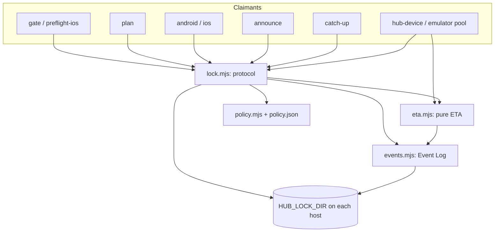
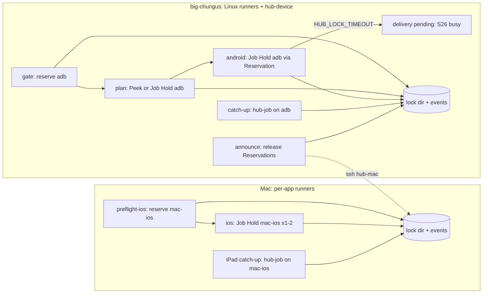

# Architecture Spine: Hub Resource Registry v1a

## Design Paradigm

**A shared library over a file-system protocol.** `tools/ci/lib/lock.mjs` is the only code that mutates `HUB_LOCK_DIR`. Every Claimant (deploy jobs, the catch-up, `hub-device`, the emulator pool) calls it in-process. There is no daemon in v1a. Several released hub versions act on one lock dir at once (pinned reruns, `current`, the `hub-device` release dir), so **the on-disk layout is the API**. The code is one implementation of it, and older readers are clients that cannot be upgraded.

| Layer | Lives in | May import |
| --- | --- | --- |
| Protocol (locks, queues, Reservations, liveness, host identity) | `tools/ci/lib/lock.mjs` | `events.mjs`, `policy.mjs`, `node:` builtins |
| Event Log (append, read) | `tools/ci/lib/events.mjs` (new) | `node:` builtins |
| ETA (pure) | `tools/ci/lib/eta.mjs` (new) | nothing; takes data in |
| Claimants | `tools/ci/commands/*.mjs`, `tools/device/*.mjs`, `catchup.mjs` | the three above, `policy.mjs` |

## Invariants & Rules



Arrows mean "may import or write". Nothing points back up, and only `lock.mjs` and `events.mjs` touch the disk.

### AD-1: One protocol owner [ADOPTED]

- **Binds:** all v1a units; NFR-1.
- **Prevents:** a second lock, queue or Reservation store, or a Claimant that reads or writes lock-dir files on its own and drifts from the protocol.
- **Rule:**
  - Every create, rename or delete under `HUB_LOCK_DIR` other than `events/` goes through an exported `lock.mjs` function.
  - Callers get structured results (`listLocks`, `listWaiters`, `listReservations`) and never parse the files.
  - The Mac's `mac-ios` lock and its queue live on the Mac's disk and are written only by processes running on the Mac.

### AD-2: The on-disk layout is versioned and additive

- **Binds:** lock dir layout, ticket and Reservation files; NFR-1, NFR-2.
- **Prevents:** a new version writing something an older pinned version misreads, then reclaims or prunes.
- **Rule:**
  - New state goes in new sibling paths that old readers ignore: `<name>.reservations/` and `events/`. `listLocks` already filters to `*.lock`.
  - Existing files keep every key they have today. New keys are additive.
  - Every new record carries `format: 1`.
  - A Reservation is never written as `<name>.lock/owner.json`.
  - A change that is not additive needs a new `format` and a spine update.

### AD-3: Ticket format v1, frozen at the v1a release

- **Binds:** `<name>.queue/` tickets; FR-8, NFR-2.
- **Prevents:** later pins pruning tickets they do not understand, which would break v2's remote waiting.
- **Rule:**
  - The file name stays `<ms15>-<counter6>-<pid8>.json`.
  - The body is `{format, kind, id, holder, why, pid, host, host_id, process_start, enqueued_at, repo, run, attempt, job, reservation, eta, expires_at}`. `kind` is one of `lease | job | hub-job | remote`.
  - Liveness:
    - A ticket with a pid is live while that process lifetime (`pid` plus `process_start`) is alive on the same host.
    - `remote`, and any kind this version does not know, is live until `expires_at`, and is live with no `expires_at`.
  - Nothing is pruned for its kind alone. v1 writes no `remote` tickets.

### AD-4: Queue scope is the Queued set

- **Binds:** `withLock`, `acquireLease`; FR-7, FR-8.
- **Prevents:** internal locks flooding the Queue and the Event Log, or one Registry lock silently staying on bare `mkdir`.
- **Rule:**
  - `QUEUED = adb, s24, mac-ios, emulator-<n>`, one exported constant in `lock.mjs`. The v1b Registry replaces its source, not its role.
  - `withLock(name)` on a Queued name joins the FIFO as `kind: job` (or `hub-job`).
  - `s3-*`, `s3-index`, `emulator-reaper` and every other name keep today's bare path and write no events.

### AD-5: Coded timeouts keep today's wording

- **Binds:** every wait on a Queued lock; FR-8, catch-up parsing.
- **Prevents:** pinned catch-ups (`catchup.mjs:469`, `:591` regex `host lock <name> is held`) misreading a queued timeout as an error, and new code matching on text.
- **Rule:**
  - Every such timeout throws `code: 'HUB_LOCK_TIMEOUT'`, with a message that starts `host lock <name> is held` and names the holder, the waiters ahead and their positions.
  - New code branches on `.code` only.
  - A cancelled place is `HUB_LEASE_CANCELLED`, and a refused extension is `HUB_LEASE_EXTEND_REFUSED`.

### AD-6: Arrival order is the file-name order

- **Binds:** queue position everywhere; FR-7, FR-9.
- **Prevents:** two versions disagreeing on who is next.
- **Rule:**
  - Position comes from sorting ticket file names together with live Reservations, whose sort key is `reserved_at`.
  - A Job Hold taken through its run's Reservation writes a ticket whose `ms15` is the Reservation's `reserved_at`. Every version that sorts names then puts it at the Reservation's place.
  - Only position 0 may `mkdir` the lock.
  - A `waitMs: 0` attempt (a phone pass in `takeAnyPhone`) is a **try**:
    - It writes no ticket.
    - It succeeds only if the lock is free and nothing live is ahead.
    - It emits an event only when it acquires.

### AD-7: Reservations are timestamp-bound, keyed by run

- **Binds:** gate, preflight-ios, plan, android, ios, announce; FR-9.
- **Prevents:** pinned versions reclaiming a Reservation as a dead job, or a rerun losing its place.
- **Rule:**
  - **File:** `<name>.reservations/<owner>--<repo>--<run_id>.json` holds `{format, run_key, repo, run, reserved_at, expires_at, grace_started_at}`.
  - **Writers:** the gate writes `adb` (Linux), and `preflight-ios` writes `mac-ios` on the Mac. If a live one exists for the run, it is reused.
  - **Same-run passthrough:** a request whose `GITHUB_REPOSITORY` and `GITHUB_RUN_ID` match is served at the Reservation's place and never waits behind it.
  - **Liveness comes only from timestamps:** `now < expires_at`, and `expires_at = reserved_at + ceiling`. There is no pid and no hostname check.
  - **Grace:**
    - It is stamped once, as `grace_started_at`, by the first acquiring Claimant that finds the Resource free with this Reservation at the head and its run not asking.
    - Read-only paths compute grace but never stamp it.
    - After grace ends, the Reservation keeps its place but never blocks a free Resource again.
  - **Release:** the last job that takes that Resource (`android` for `adb`, `ios` for `mac-ios`) releases it in `finally`. `announce` releases both as a backstop, locally and over ssh to `hub-mac`. Otherwise the ceiling ends it.

### AD-8: Same-host identity uses a machine id

- **Binds:** tickets, owners and liveness checks written by v1a+.
- **Prevents:** mDNS hostname drift on the Mac (`mommymac.local` becomes `mommymac-2.local`) making a live waiter look foreign and get pruned.
- **Rule:**
  - New records add `host_id` (Linux `/etc/machine-id`, Mac `IOPlatformUUID`, cached per process) beside `host = os.hostname()`.
  - Two records are on the same host when both carry `host_id` and the ids are equal. Otherwise they are compared by hostname.
  - Older versions see a foreign host and fall back to their conservative rule: expiry for a Lease, 4 h for a job.

### AD-9: Event Log, exactly once, never fatal

- **Binds:** every Hold and Reservation transition; FR-17.
- **Prevents:** double-counted or missing transitions, and history writes that break a deploy.
- **Rule:**
  - **Location:** the log lives at `<lockdir>/events/<YYYY-MM>.jsonl` on the host that owns the lock.
  - **Format:** each event is one JSON line under 4 KiB, appended with a single `O_APPEND` write.
  - **Only the process whose atomic step succeeded writes the event.** The atomic steps are `mkdir`, `rename`, `unlink`, and a `wx` create. A reader never writes the event for a transition it only observed.
  - A write failure logs `HUB_EVENT_LOG_FAILED` and the transition still happens.
  - `hub-device status` and every read-only path write nothing.
  - Events cover only Queued locks (AD-4).

### AD-10: hub_version has one source

- **Binds:** Event Log, receipts, logs.
- **Prevents:** recording the app version (`HUB_VERSION`) as the hub version, and different resolvers in different modules.
- **Rule:** `hubVersion()` in `events.mjs` resolves, in order:
  1. `HUB_REF`, which the action sets to the caller's `@vX.Y.Z`.
  2. The release dir name in the running module's path.
  3. `unknown`.

### AD-11: Queue tuning is policy

- **Binds:** grace, Reservation ceiling, wait margin, per-lock hold allowance, deploy-target Lease cap, catch-up attempt, ETA window; FR-8, FR-9, FR-15, FR-31.
- **Prevents:** two Claimants passing different values, and env or inputs overriding policy.
- **Rule:**
  - The values live in one strict `queue` block in `tools/ci/policy.json`, starting at grace 10 min, ceiling 180 min, margin 2 min and deploy-target Lease cap 60 min.
  - `lock.mjs` reads them through `loadPolicy` itself. Callers never pass them, and tests inject a policy object.
  - Changing a value is a hub release.

### AD-12: Wait deadline for deploy jobs

- **Binds:** plan, android, ios waits; FR-8.
- **Prevents:** GitHub killing a waiting job before it can report its own reason and the Holds ahead.
- **Rule:**
  - `deadline = job_start + job_timeout - margin - hold_allowance[lock]`.
  - `job_timeout` reaches tools as `HUB_JOB_TIMEOUT_MINUTES`, set per job in `mobile-deploy.yml` beside `timeout-minutes`. A conformance test asserts that the two are equal.
  - `job_start` is the start time of the nearest `Runner.Worker` ancestor process, or the tool process's own start if there is none.
  - Claimant identity comes from the runner's `GITHUB_REPOSITORY`, `GITHUB_RUN_ID`, `GITHUB_RUN_ATTEMPT` and `GITHUB_JOB`. That is identity, not policy.

### AD-13: The Peek never disturbs a Lease

- **Binds:** plan's installed-version read; FR-9.
- **Prevents:** plan blocking behind a Lease, or restarting or reconnecting the leaseholder's adb.
- **Rule:**
  - When `adb` is held by a Lease, plan reads the S26's installed version without the lock.
  - It goes through the adb server that is already listening (the Lease's `adb_port` and `adb_id` when recorded) with `RUNNER_TRACKING_ID` blank.
  - It never runs `start-server`, `connect` or mDNS.
  - No server or no device means the installed version is `unknown`. Plan proceeds, and the install-time newer-device refusal (`android.mjs:126`) is the guard.
  - A Job Hold of another deploy is waited for in the Queue as usual.

### AD-14: Contention goes pending on Android; public data stays coarse

- **Binds:** `android.mjs`, `latest.json`, receipts; FR-30.
- **Prevents:** a run going red because a phone was busy, and leaking holder details to the public bucket.
- **Rule:**
  - `android.mjs` catches `HUB_LOCK_TIMEOUT` on `adb` and marks the delivery `pending` with the public reason `S26 busy`.
  - It uses the frozen `latest.json` status enum and adds no keys.
  - Holder identity and the blocking Holds go only to the receipt and the Event Log.
  - The run is green for Android, so the Play upload and the release proceed for a contention-pending build. That is an intended change.
  - The catch-up delivers the build as `kind: hub-job` in its turn (AD-15).

### AD-15: The catch-up queues as a hub job

- **Binds:** `catchup.mjs` on both hosts; FR-7, FR-12.
- **Prevents:** the catch-up skipping the Queue, or being counted as a starved deploy.
- **Rule:**
  - The catch-up enqueues on `adb` or `mac-ios` as `kind: hub-job`, with the policy attempt budget (seconds), and only when it has a pending build for that Resource.
  - On `HUB_LOCK_TIMEOUT` it removes its ticket and reports `HUB_CATCHUP_IDLE`.
  - The iPad catch-up and the iOS jobs share the one `mac-ios` FIFO on the Mac.

### AD-16: Lease expiry only moves through `extendLease`

- **Binds:** `lock.mjs`, `hub-device`; FR-31.
- **Prevents:** a renewal overwriting the next holder, or a deploy-target Lease outliving the Queue's patience.
- **Rule:**
  - Every change that makes a Lease's `expires_at` later goes through `extendLease`.
  - `extendLease` refuses with `HUB_LEASE_EXTEND_REFUSED` (naming the waiters and their positions):
    - while a live ticket or live Reservation waits on that lock;
    - at or after expiry.
  - It caps Leases on deploy targets (`adb`, `mac-ios`) at the policy cap.
  - `updateLease` keeps metadata-only changes and gains the at-or-after-expiry refusal.
  - A `hub-device lease` on a deploy target asking for more than the cap exits 2, naming the cap and pointing at `s24` or an emulator.

### AD-17: The CLI only grows

- **Binds:** `hub-device`; FR-13, FR-16.
- **Prevents:** breaking scripts and agents that parse today's output.
- **Rule:**
  - Commands, exit codes (75, 76, 1, 2, 127, 128+N) and `HUB_DEVICE_*` lines stay as they are. stdout carries only `export` lines.
  - Status text is unchanged, except that new sections (waiters by kind with repo, run and job; Reservations) print only when non-empty.
  - `--json` gains keys and never renames or removes one.
  - The one intended text change is the wait line: `HUB_LOCK_WAIT <name> held by <holder> position=<n> eta=<range>`. It prints on a position change or when the ETA moves by more than a minute.

### AD-18: The ETA is a pure function

- **Binds:** `eta.mjs`, the wait line, status; FR-15, FR-16.
- **Prevents:** each surface computing its own ETA, and status reads becoming slow scans.
- **Rule:**
  - `eta(queueSnapshot, events, policy, now)` returns `{lo_ms, hi_ms, low_data}`.
  - The range is the IQR of matching past holds: jobs by repo and job, Leases by kind times the share of their stated duration used.
  - With thin history it widens to stated durations or job timeouts and sets `low_data`.
  - It is computed at enqueue and on a position change, never on every poll.
  - The enqueue ETA is stored in the ticket and in the `request` event.

### AD-19: No new clock [ADOPTED]

- **Binds:** expiry, reclaim, grace, liveness; NFR-3.
- **Prevents:** reapers, timers or daemons appearing to clean the lock dir.
- **Rule:**
  - Expiry, reclaim and grace are decided by whichever Claimant calls the library, from timestamps.
  - The only in-process interval is a holder touching its own `owner.json` mtime at most once a minute while it holds (an `unref`'d timer). A reclaim records that mtime as `last_alive_at`.
  - Recurring work stays in Candybar.

## Consistency Conventions

| Concern | Convention |
| --- | --- |
| Error shape | `Error` with `.code` `HUB_*`; callers branch on code; message stays human. |
| Log lines | UPPER_SNAKE marker first (`HUB_LOCK_WAIT`, `HUB_LOCK`, `HUB_LOCK_RECLAIMED`, `HUB_EVENT_LOG_FAILED`, `HUB_CATCHUP_IDLE`), then `key=value`. |
| Timestamps | ISO-8601 UTC strings in files; `*_ms` integers for durations; the ios-lane's are all Mac clock. |
| Ids | Lease id as today; job ticket id `<repo>#<run>.<attempt>/<job>`; Reservation run key `<repo>#<run>`. |
| Event shape | `{format:1, ts, host, host_id, hub_version, event, lock, claimant:{kind, holder, repo, run, attempt, job}, id, waited_ms, held_ms, eta, reason, blocked_by, last_alive_at}`; `event` ∈ request, acquire, release, extend, timeout, cancel, claim, expiry, reclaim, force-release. |
| Atomic writes | One helper in `lock.mjs` (tmp + rename, `wx` for create-once); no new copies. |
| Seams | New lock-dir code takes `{env, now, sleep, log, host, hostId, processStart, policy}`; never calls `hostname()`, `Date.now()` or reads process start directly. |
| Tests | `node --test`, `hermetic()`, temp lock dir, every seam injected; one test per AD's Rule; the intended `HUB_LOCK_WAIT` text change named in its test. |
| Liveness cost | Process-start checks cached per pid per poll pass; lease polls ≥ 1 s, job polls ≥ 2 s (Mac `ps` spawn cost). |

## Stack

| Name | Version |
| --- | --- |
| Node.js (mise `node = "24"`) | 24.x LTS, 24.22.3 current |
| Dependencies | none (`node:` builtins only) |
| GitHub Actions runners | self-hosted big-chungus (Linux) and Mac, as today |

## Structural Seed

```text
HUB_LOCK_DIR/                    # ~/.cache/mobile-deploy-hub/locks on each host
  adb.lock/owner.json            # today's owner; + host_id, format (additive)
  adb.queue/<ms15>-<ctr6>-<pid8>.json      # ticket v1 (AD-3)
  adb.reservations/<owner>--<repo>--<run>.json  # Reservation (AD-7), new
  s24.lock/ ...  emulator-<n>.lock/ ...
  s3-*.lock/ s3-index.lock/ emulator-reaper.lock/  # bare, no queue, no events
  events/<YYYY-MM>.jsonl         # Event Log (AD-9), new
# On the Mac: mac-ios.lock/, mac-ios.queue/, mac-ios.reservations/, events/
```



Roll-out per NFR-2: `hub-device` switches at `hosts:install`, and the catch-ups switch at the first real deploy on the new pin. Fairness holds only among runs on the new pin.

## Capability → Architecture Map

| Capability | Lives in | Governed by |
| --- | --- | --- |
| FR-7 FIFO for every Claimant | `lock.mjs` | AD-3, AD-4, AD-6, AD-15 |
| FR-8 deploy jobs in the Queue | `lock.mjs` `withLock`; commands | AD-4, AD-5, AD-12 |
| FR-9 Reservations | `lock.mjs`; gate, preflight-ios, plan, android, ios, announce | AD-6, AD-7, AD-13 |
| FR-12 ios-lane Queue (v1a part) | `lock.mjs` on the Mac; `ios.mjs`, `catchup.mjs` | AD-1, AD-7, AD-8, AD-15 |
| FR-13 CLI compatibility | `hub-device.mjs` | AD-17 |
| FR-15 / FR-16 ETA and wait line | `eta.mjs`; `lock.mjs` logging; `hub-device` | AD-17, AD-18 |
| FR-17 Event Log | `events.mjs` | AD-9, AD-10, AD-19 |
| FR-30 pending not red | `android.mjs`, `latest.mjs`, receipt | AD-14, AD-15; iOS: Open Question 1 |
| FR-31 no extension while waiting | `lock.mjs` `extendLease`; `hub-device` | AD-11, AD-16 |
| NFR-1 / NFR-2 one impl, pinned runs | `lock.mjs` | AD-1, AD-2, AD-3, AD-6, AD-8 |
| NFR-3 no new clock | all | AD-19 |

## Open Questions

1. **FR-30 on iOS.** `mac-ios` wraps the Xcode build, export and install (`ios.mjs:276`). An `ios-lane` wait that runs out therefore leaves no artifact for the catch-up.
   - v1a ships iOS contention as a red iOS job with `HUB_LOCK_TIMEOUT` naming the holders.
   - The preflight Reservation, the 60-minute Lease cap and the 120-minute job timeout keep it rare.
   - Making it pending needs the build split from the `ios-lane` Hold, which §7.2 defers. This is a PRD deviation for Jarad.

## Deferred

- **Registry as the source of `QUEUED`, `lease ipad|mac`, the Hub API and the Mac Host Agent:** v1b (§7.1). AD-4 keeps the role stable.
- **The `extend` CLI verb and Jarad's override:** v1b and v1c with FR-10 and FR-11. AD-16 fixes the rule they must call.
- **Remote waiting, Heartbeats and fencing:** v2. AD-3 already reserves `kind: remote` and `expires_at`.
- **Event Log rotation and compaction:** after 100 MB. Monthly files leave room for it without a format change.
- **Cross-host Event Log merge and history queries (FR-18):** v1b Hub API. Each host's log stays local in v1a.
- **GitHub concurrency-group cancellation of pending runs:** outside the hub, and not counted by SM-1.
