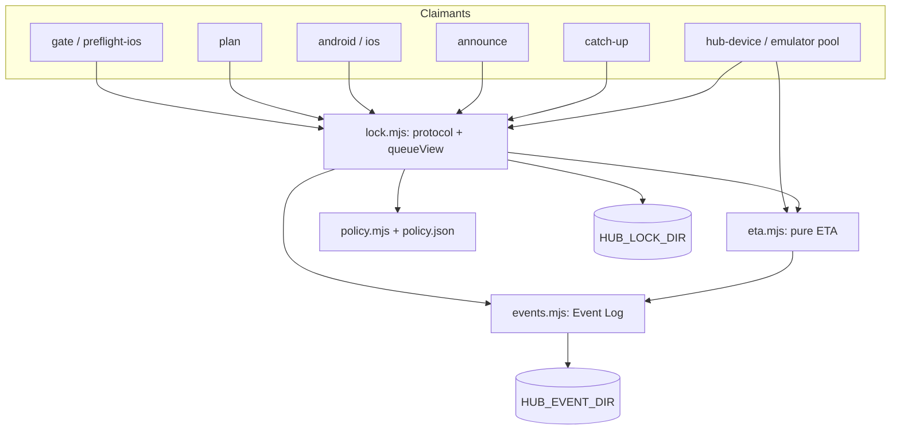
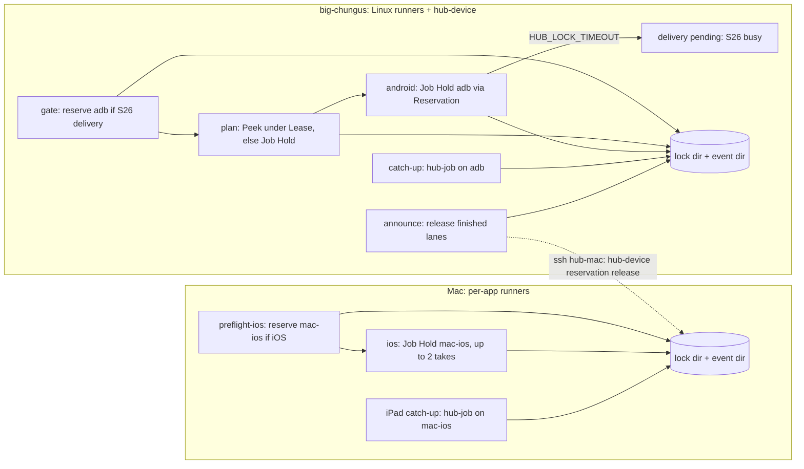

# Architecture Spine: Hub Resource Registry v1a

## Design Paradigm

**A shared library over a file-system protocol.** `tools/ci/lib/lock.mjs` is the only code that mutates the protocol paths in `HUB_LOCK_DIR`. Every Claimant (deploy jobs, the catch-up, `hub-device`, the emulator pool) calls it in-process. v1a has no daemon. Several released hub versions act on one lock dir at once: pinned reruns, `current` and the `hub-device` release dir. **The on-disk layout is the API.** The code is one implementation of it, and older readers are clients that cannot be upgraded.

| Layer | Lives in | May import |
| --- | --- | --- |
| Protocol: locks, queues, Reservations, liveness, host identity, `queueView` | `tools/ci/lib/lock.mjs` | `events.mjs`, `policy.mjs`, `node:` builtins |
| Event Log: append and read | `tools/ci/lib/events.mjs` (new) | `receipt.mjs` (`hubRef`), `node:` builtins |
| ETA (pure) | `tools/ci/lib/eta.mjs` (new) | nothing; data comes in as arguments |
| Claimants | `tools/ci/commands/*.mjs`, `tools/device/*.mjs`, `catchup.mjs` | `lock.mjs`, `eta.mjs`, `policy.mjs` |

## Invariants & Rules



Arrows mean "may import or write". Nothing points back up. Only `lock.mjs` writes protocol paths, and only `lock.mjs` calls the append in `events.mjs`.

### AD-1: One protocol owner [ADOPTED]

- **Binds:** all v1a units; NFR-1.
- **Prevents:** a second lock, queue or Reservation store, or a Claimant that parses or writes protocol files itself.
- **Rule:**
  - Every create, rename or delete of `<name>.lock`, `<name>.queue/`, `<name>.reservations/` goes through an exported `lock.mjs` function. Every event append does too.
  - Callers read through `listLocks`, `queueView` and `listReservations`, and never parse those files.
  - `emulator.mjs` keeps its own `emulators/` and `emulator-pool` state, but moves its gate-ticket parsing (`:329-332`) onto `queueView`.
  - The Mac's `mac-ios` lock, queue and Reservations live on the Mac's disk. Only processes on the Mac write them.

### AD-2: The on-disk layout is versioned and additive

- **Binds:** lock-dir layout, owner, ticket and Reservation files; NFR-1, NFR-2.
- **Prevents:** a new version writing something an older pinned version misreads, then reclaims or prunes.
- **Rule:**
  - New state goes in sibling paths that old readers ignore: `<name>.reservations/`, `<name>.lock/alive`, and tombstones named outside `*.lock`.
  - Existing files keep every key they have today. New keys are additive: `owner.json` gains `format`, `kind`, `repo`, `run`, `attempt`, `job`, `host_id`.
  - Every new record carries `format: 1`.
  - A Reservation is never written as `<name>.lock/owner.json`.
  - A change that is not additive needs a new `format` and a spine update.

### AD-3: Ticket format v1, frozen at the first queue-joining release

- **Binds:** `<name>.queue/` tickets; FR-8, NFR-2.
- **Prevents:** a dead or malformed ticket blocking a lock forever on pins that can't be patched. Also prevents later pins pruning what they do not understand.
- **Rule:**
  - **File name:** stays `<ms15>-<counter6>-<pid8>.json`.
  - **Body:** `{format, kind, lease_id, holder, why, pid, host, host_id, process_start, enqueued_at, deadline_at, expires_at, repo, run, attempt, job, reservation, request, pool, eta, delivery}`.
    - `kind` is one of `lease`, `job`, `hub-job`, `remote`.
    - Every ticket carries `lease_id`, `holder` and `why`. Job tickets use the id `job:<repo>#<run>.<attempt>/<job>`, which can never collide with a Lease id.
    - `enqueued_at` is the real request time.
  - **Liveness, in this order:**
    1. A missing `kind` means `lease`.
    2. A ticket with a `pid` follows the pid rule: live while that process lifetime is alive on the same host (AD-8). It is stale only on positive evidence of death. An unreadable process start keeps it live.
    3. A ticket with no `pid` is live while `expires_at` is in the future.
    4. A ticket with no `pid` and no `expires_at` is stale 60 s after `enqueued_at`.
  - Nothing is pruned for its kind alone.
  - v1 writes no `remote` tickets. v2 may write them only after every pin from before the freeze has aged out (30 days), because `staleWaiter` before v1a deletes pid-less tickets.

### AD-4: Queue scope is the Queued set

- **Binds:** `withLock`, `acquireLease`, Pool requests; FR-7, FR-8, FR-17.
- **Prevents:** internal locks flooding the Queue and the Event Log. Also prevents one Registry lock, or one Pool, staying invisible to history.
- **Rule:**
  - `QUEUED = adb, s24, mac-ios, emulator, emulator-<n>` is one exported constant in `lock.mjs`. The v1b Registry replaces its source, not its role.
  - `withLock(name)` on a Queued name joins the FIFO as `kind: job` or `kind: hub-job`.
  - `s3-*`, `s3-index`, `emulator-reaper` and every other name keep today's bare path and write no events.
  - A Pool request (`phone`, `emulator`) writes one Pool-level `request` event and then one `acquire` or `timeout` event. It writes them from the requesting process through `lock.mjs`, with `waited_ms` measured from the start of the outer request.

### AD-5: Coded timeouts keep today's wording

- **Binds:** every wait on a Queued lock; FR-8, catch-up parsing.
- **Prevents:** a catch-up in `current` that is older than the new pin misreading a queued timeout as an error. Also prevents new code matching on text.
- **Rule:**
  - Every such timeout throws `code: 'HUB_LOCK_TIMEOUT'` with a message that starts `host lock <name> is held` and names the holder, the waiters ahead and their positions.
  - New code branches on `.code` only.
  - Other codes:
    - A lost place is `HUB_LEASE_CANCELLED`.
    - A refused extension is `HUB_LEASE_EXTEND_REFUSED`.
    - A rewrite after losing the lock is `HUB_LEASE_LOST`.

### AD-6: One queue view: place is not blocking

- **Binds:** every acquire, try, extension check and status; FR-7, FR-9.
- **Prevents:**
  - Two versions or two callers disagreeing on who is next.
  - A Reservation past its grace blocking a lock for hours.
  - A run counted twice.
- **Rule:**
  - **`queueView(name)`** is exported once, from `lock.mjs`. Every caller uses it, `hub-device status` included (today `:507`).
  - **Sort key:** a ticket's file name; for a Reservation, its `reserved_at` ms. Ties break on the full name string.
  - **Hiding:** a Reservation is hidden while its run has a live ticket. A Job Hold taken through its Reservation writes a ticket whose `ms15` is the Reservation's `reserved_at`, so it stands at that place in every version.
  - **What blocks:**
    - Every live ticket blocks.
    - Only the first Reservation in line may block, and only until its grace ends (AD-7).
    - Other Reservations hold a place but block nothing.
  - **Acquire:**
    - A Claimant may `mkdir` the lock only when nothing that blocks is ahead of it.
    - After `mkdir` it re-reads `queueView`. If an entry that blocks now sits ahead, it releases the lock and waits.
  - **A `waitMs: 0` attempt is a try:**
    - It writes no ticket.
    - It succeeds only if the lock is free and nothing blocks.
    - It writes an event only when it acquires.

### AD-7: Reservations are directories, timestamp-bound, keyed by run

- **Binds:** gate, preflight-ios, plan, android, ios, announce; FR-9.
- **Prevents:**
  - A grace stamp bringing back a released Reservation.
  - Pinned versions reclaiming a Reservation as a dead job.
  - Two pins disagreeing on grace.
  - A rerun losing its place.
- **Rule:**
  - **Layout:** `<name>.reservations/<owner>--<repo>--<run>/` holds:
    - `reservation.json`, written once (`wx`): `{format, run_key, repo, run, reserved_at, expires_at, grace_ms}`;
    - `grace.json`, created once (`wx`), holding `grace_started_at`.

    Readers use the record's absolute times and `grace_ms`, never their own policy.
  - **Writers:** the gate reserves `adb` (on Linux) only when the run will install to the S26. `preflight-ios` reserves `mac-ios` (on the Mac) only when iOS is in scope. A live Reservation for the run is reused.
  - **Same-run passthrough:** a request whose `GITHUB_REPOSITORY` and `GITHUB_RUN_ID` match the Reservation's is served at the Reservation's place and never waits behind it.
  - **Liveness** comes only from timestamps: `now < expires_at`. No pid or hostname check applies.
  - **Grace:**
    - The first acquiring Claimant or try that finds the lock free, with this Reservation first in line and its run not asking, creates `grace.json`.
    - Read-only paths compute grace and never create the file.
    - Grace ends at `grace_started_at + grace_ms`.
  - **Release:**
    - Release renames the directory to `.released-<key>-<ms>` *before* the lock is freed. A late grace stamp then fails with ENOENT.
    - A Reservation is released only when no later job of the run will take the device:
      - `android` on success or contention-pending;
      - `ios` on success;
      - `plan` when the run skips the Android lane.
    - On failure it is left to grace and the ceiling, so `gh run rerun --failed` keeps its place.
    - `announce` releases lanes that ended in success or pending. On the Mac it does this through `ssh hub-mac` running the installed `hub-device` wrapper at its absolute path (`hub-device reservation release --run <key>`). It never runs `rm` over ssh. If the Mac's release lacks the verb, the ceiling ends the Reservation.

### AD-8: Same-host identity uses a machine id

- **Binds:** tickets, owners and liveness checks written by v1a and later.
- **Prevents:** mDNS hostname drift on the Mac (`mommymac.local` becoming `mommymac-2.local`) making a live waiter look foreign.
- **Rule:**
  - New records add `host_id` beside `host = os.hostname()`. On Linux it comes from `/etc/machine-id`; on the Mac from `IOPlatformUUID`, cached per process.
  - Two records are on the same host when both carry `host_id` and the ids are equal. Otherwise they are compared by hostname.
  - Owners from before v1a: an owner from another host is honoured until its expiry (for a Lease) or for 4 h (for a job).
  - Tickets from before v1a: a ticket from another host is pruned. AD-3 accounts for this.

### AD-9: Event Log, exactly once, never fatal

- **Binds:** every transition on a Queued lock, Pool request and Reservation; FR-17.
- **Prevents:** double-counted or missing transitions, history lost with a cache wipe, and history writes that break a deploy.
- **Rule:**
  - **Location:** `HUB_EVENT_DIR`, default `$XDG_STATE_HOME/mobile-deploy-hub/events/<YYYY-MM>.jsonl`, on the host that owns the lock.
  - **Write:** one JSON line under 4 KiB per transition, in a single `O_APPEND` write.
  - **Who writes:** only the process whose deciding step succeeded writes the event:

    | Event | Deciding step |
    | --- | --- |
    | request | `wx` create of the ticket |
    | acquire | `mkdir` of `<name>.lock` that survives the re-check |
    | release, reclaim, force-release | `rename` of `<name>.lock` to `<name>.lock.tomb-<ms>-<pid>` |
    | cancel, timeout, prune | `unlinkSync` of the ticket (ENOENT means it lost; no event) |
    | claim | `wx` create of `reservation.json` |
    | grace | `wx` create of `grace.json` |
    | Reservation release, expiry | `rename` of the Reservation dir |
    | extend | owner rewrite that passes AD-16 |
    | refused | catch-up `ahead` decision (AD-15) |

  - **No forced removal on these paths:** nothing on these paths uses a forced `rmSync`. The winner deletes its own tomb.
  - **Read-only status:** `hub-device status` writes nothing. Its emulator reap (`:701`) moves to the emulator acquire paths.
  - **Failures:** a write failure logs `HUB_EVENT_LOG_FAILED`, and the transition still happens.
  - **Sequence tests:** these tests pin the event sequences: a full deploy run, a Lease, an emulator Lease, a pending delivery and a timed-out wait.

### AD-10: hub_version has one source

- **Binds:** Event Log, receipts, logs.
- **Prevents:** recording the app version (`HUB_VERSION`) as the hub version, and a second resolver.
- **Rule:**
  - `hubRef()` in `receipt.mjs` stays the only resolver. Its order is:
    1. `HUB_REF`.
    2. The `_actions/…/<ref>/` path.
    3. The release-dir name (new).
    4. `null`, which is written as `unknown`.
  - `events.mjs` imports it.

### AD-11: Queue tuning is policy, stamped into the records

- **Binds:** grace, Reservation ceiling, wait margin, per-job hold allowance, deploy-target Lease cap, catch-up waits, ETA window and low-data threshold; FR-8, FR-9, FR-15, FR-31.
- **Prevents:** two Claimants or two pins applying different values to one record, and env or inputs overriding policy.
- **Rule:**
  - The values live in one strict `queue` block in `tools/ci/policy.json`. Starting values: grace 10 min, ceiling 180 min, margin 2 min, deploy-target Lease cap 60 min.
  - `lock.mjs` reads them through `loadPolicy` itself. Callers never pass them, and tests inject a policy object.
  - A writer stamps the values that govern others into its record as absolute times or durations: `expires_at`, `grace_ms`, `deadline_at`. Readers use the record.
  - Changing a value is a hub release.

### AD-12: Wait deadline for deploy jobs

- **Binds:** plan, android, ios waits; FR-8.
- **Prevents:** GitHub cancelling a waiting job before it can report its own reason. A job killed at `timeout-minutes` ends `cancelled`, `finally` never runs and deliver-* is skipped.
- **Rule:**
  - `deadline = job_start + job_timeout - margin - hold_allowance[job]`. The allowance covers every hold the job still has to take: `ios` takes `mac-ios` up to twice.
  - `job_timeout` reaches tools as `HUB_JOB_TIMEOUT_MINUTES`, set per job in `mobile-deploy.yml` beside `timeout-minutes`. A test in `mise run check` asserts the two are equal.
  - `job_start` is the nearest `Runner.Worker` ancestor's process start (verified equal to GitHub's `started_at`). Failing that, it is the tool's own start.
  - Claimant identity comes from the runner's `GITHUB_REPOSITORY`, `GITHUB_RUN_ID`, `GITHUB_RUN_ATTEMPT` and `GITHUB_JOB`. Identity is not policy.

### AD-13: Device reads under a Lease never start or reconnect adb

- **Binds:** plan's Peek and the gate's `quickS26` probe; FR-9.
- **Prevents:** plan blocking behind a Lease, and a deploy restarting or reconnecting the leaseholder's adb.
- **Rule:**
  - When `adb` is held by a Lease, these reads take no lock. They run only `adb -L tcp:127.0.0.1:<port> -s <id> …`, which refuses to launch a server. The port and id are the Lease's `adb_port`/`adb_id` when recorded, else the default server.
  - `RUNNER_TRACKING_ID` is blank.
  - They never run `start-server`, `connect` or mDNS.
  - A connect failure, or a missing device, means the installed version is `unknown`.
  - Plan then proceeds. The install-time newer-device refusal (`android.mjs:126`) is the guard, and the catch-up's `ahead` check covers builds that went pending.
  - A Job Hold of another deploy is waited for in the Queue.

### AD-14: Contention goes pending on Android; public data stays coarse

- **Binds:** `android.mjs`, `latest.json`, receipts, pages; FR-30.
- **Prevents:** a run going red because a phone was busy, and leaking holder details to the public bucket.
- **Rule:**
  - `android.mjs` catches `HUB_LOCK_TIMEOUT` on `adb` and marks the delivery `pending` with the public reason `S26 busy`. It uses the frozen `latest.json` status enum and adds no keys.
  - Holder identity and the blocking Holds go only to the receipt and the Event Log (a `timeout` event with `reason: delivery-pending` and `blocked_by`).
  - The run is green for Android, so the Play upload and the release proceed for a contention-pending build. This change is intended.

### AD-15: The catch-up queues as a hub job

- **Binds:** `catchup.mjs` on both hosts; FR-7, FR-12, FR-30.
- **Prevents:**
  - The catch-up skipping the Queue.
  - A contention-pending build never getting its turn.
  - A refusal that goes unexplained.
- **Rule:**
  - The catch-up enqueues on `adb` or `mac-ios` as `kind: hub-job`, and only when it has a pending build for that Resource. Its ticket and events carry `delivery {repo, run, version}`.
  - **Wait length:**
    - With a contention-pending build, it waits up to the policy's `catchup_pending_wait`, bounded by its pass limit.
    - Otherwise it waits the short policy attempt.
  - On `HUB_LOCK_TIMEOUT` it removes its ticket and reports `HUB_CATCHUP_IDLE`.
  - **Newer build already installed (`ahead`):** it writes a `refused` event naming the Lease holders since the pending event. `latest.json` records `skipped` with a coarse reason.
  - The iPad catch-up and the iOS jobs share the one `mac-ios` FIFO on the Mac.

### AD-16: Lease expiry only moves later through `extendLease`

- **Binds:** `lock.mjs`, `hub-device`, `emulator.mjs`; FR-31.
- **Prevents:**
  - A renewal overwriting the next holder's record.
  - A deploy-target Lease outliving the Queue's patience.
  - A Reservation past its grace refusing extensions for hours.
- **Rule:**
  - **`extendLease`** is the only path that moves `expires_at` later. It refuses with `HUB_LEASE_EXTEND_REFUSED` (naming the waiters and their positions):
    - while any entry in `queueView` that blocks is waiting;
    - at or after expiry.
  - It caps Leases on deploy targets (`adb`, `mac-ios`) at the policy cap. `acquireLease` applies the same cap.
  - `updateLease` may only move expiry earlier, or change metadata.
  - **Every owner rewrite** first checks that `lease_id`, and the lock dir inode recorded at acquire, still match. If not, it throws `HUB_LEASE_LOST`.
  - A `hub-device lease` on a deploy target asking for more than the cap exits 2, naming the cap and pointing at `s24` or an emulator.

### AD-17: The CLI only grows

- **Binds:** `hub-device`; FR-13, FR-16.
- **Prevents:** breaking scripts and agents that parse today's output.
- **Rule:**
  - Commands, exit codes (75, 76, 1, 2, 127, 128+N) and `HUB_DEVICE_*` lines stay as they are. A successful `lease` prints only `export` lines on stdout.
  - Status text is unchanged, except:
    - waiters render by kind (repo, run and job for jobs; never `undefined`);
    - new sections (Reservations, ETA) print only when non-empty.
  - `--json` gains keys and never renames or removes one.
  - New verbs may be added (`reservation release`). `release <id>` refuses `job:` ids.
  - **Intended text changes, each named in its test:**
    - the wait line becomes `HUB_LOCK_WAIT <name> held by <holder> position=<n> eta=<range>`;
    - the queued-timeout message follows AD-5 (`lease.test.mjs:203`).

### AD-18: The ETA is a pure function

- **Binds:** `eta.mjs`, the wait line, status; FR-15, FR-16.
- **Prevents:** each surface computing its own ETA, and waits re-scanning history on every poll.
- **Rule:**
  - `eta(queueView, events, policy, now)` returns `{lo_ms, hi_ms, low_data}`.
  - **Range:** the IQR of matching past holds:
    - jobs are matched by repo and job;
    - Leases by Claimant kind × the share of `for_ms` they used, clamped to `expires_at`.
  - **Low data:** below the policy threshold, the range widens to stated durations or `deadline_at` and sets `low_data`.
  - **When computed:** waiters compute at enqueue, on a position change, and at most every 5 min.
  - **Wait line:** it prints on a position change, or when the ETA moves by more than a minute.
  - **Status** computes the ETA live, read-only, over the policy window only.
  - **Recording:** the enqueue ETA is stored in the ticket and in the `request` event.

### AD-19: No new clock [ADOPTED]

- **Binds:** expiry, reclaim, grace, liveness; NFR-3.
- **Prevents:** reapers, timers or daemons appearing to clean the lock dir.
- **Rule:**
  - Expiry, reclaim and grace are decided from timestamps by whichever Claimant calls the library.
  - The only in-process interval is a holder touching `<name>.lock/alive` at most once a minute from its async paths (an `unref`'d timer).
  - **What a reclaim records:**
    - For a job: `last_alive_at` = the mtime of `alive`, flagged `approx` (a synchronous child can block the touch).
    - For a Lease: `held_ms` ends at the earlier of `expires_at` and observed death.
  - Recurring work stays in Candybar.

### AD-20: The freeze set ships together

- **Binds:** release planning for v1a epics; NFR-2.
- **Prevents:** a first queue-joining pin that lacks part of the protocol. Its reruns would ignore the missing part for 30 days.
- **Rule:**
  - These land in the first release whose deploy jobs join the Queue:
    - ticket v1 and its liveness rules;
    - `queueView`;
    - the Reservation dir format with its grace record;
    - `host_id`;
    - tries;
    - coded timeouts;
    - tombstone reclaim and release;
    - the owner-rewrite check.
  - The Event Log may ship in an earlier release.
  - `hosts:install` runs on both hosts right after that release, so `hub-device`, the wrapper on the Mac, and `announce`'s ssh verb all speak the same format.

### AD-21: The Queue replaces lane concurrency groups [ADOPTED]

- **Binds:** `.github/workflows/mobile-deploy.yml`; FR-8, SM-1.
- **Prevents:** GitHub's one-pending-per-group replacement silently dropping a run that the Queue would have served.
- **Rule:**
  - The `android` and `ios` jobs lose their per-repo `concurrency` groups.
  - `plan` keeps its group: a newer pending run of a repo supersedes an older one, and SM-1 does not count that.
  - `ios-export` and `deliver-*` keep theirs.

## Consistency Conventions

| Concern | Convention |
| --- | --- |
| Error shape | An `Error` with a `.code` of the form `HUB_*`. Callers branch on the code; the message stays human. |
| Log lines | An UPPER_SNAKE marker first (`HUB_LOCK_WAIT`, `HUB_LOCK`, `HUB_LOCK_RECLAIMED`, `HUB_EVENT_LOG_FAILED`, `HUB_CATCHUP_IDLE`), then `key=value`. |
| Timestamps | ISO-8601 UTC strings in files, `*_ms` integers for durations. Every `ios-lane` timestamp comes from the Mac clock. |
| Ids | Lease ids stay as today. A job ticket is `job:<repo>#<run>.<attempt>/<job>`. A Reservation run key is `<repo>#<run>`, and its dir is `<owner>--<repo>--<run>`. |
| Event shape | `{format:1, ts, host, host_id, hub_version, event, lock, pool, request, hold_kind, claimant:{kind: deploy\|hub-job\|agent\|person, holder, repo, run, attempt, job}, lease_id, for_ms, expires_at, deadline_at, waited_ms, held_ms, eta, reason, blocked_by, last_alive_at, delivery}` |
| Atomic writes | One helper in `lock.mjs`: tmp file plus rename, `wx` for create-once, rename to a tomb for removals that write an event. No new copies of the helper. |
| Seams | New protocol code takes `{env, now, sleep, log, host, hostId, processStart, policy}`. It never calls `hostname()` or `Date.now()` directly, and never reads a process start itself. |
| Tests | `node --test`, `hermetic()`, a temp lock dir and a temp event dir, every seam injected. One test per AD Rule, plus the five FR-17 sequences. Each intended text change is named in its test. |
| Liveness cost | Process-start checks are cached per pid for each poll pass. Lease polls run at most once a second and job polls at most once every 2 s, because `ps` spawns are costly on the Mac. |

## Stack

| Name | Version |
| --- | --- |
| Node.js | >= 24 (24.22.3 newest 24.x, Maintenance LTS). Runners use 26.x via PATH in `action.yml`. Catch-ups and the `hub-device` wrapper use mise `node/24`. |
| CI test matrix | `mise run check` on Node 24 and 26 (`check.yml`) |
| Dependencies | none (`node:` builtins only) |
| Runners | self-hosted big-chungus (Linux) and the Mac per-app runners, as today |

## Structural Seed

```text
HUB_LOCK_DIR/                          # ~/.cache/mobile-deploy-hub/locks on each host
  adb.lock/owner.json                  # today's owner + format, kind, repo, run, attempt, job, host_id
  adb.lock/alive                       # holder liveness touch (AD-19)
  adb.lock.tomb-<ms>-<pid>/            # transient: release/reclaim winner (AD-9)
  adb.queue/<ms15>-<ctr6>-<pid8>.json  # ticket v1 (AD-3)
  adb.reservations/<owner>--<repo>--<run>/{reservation.json,grace.json}   # AD-7
  adb.reservations/.released-<key>-<ms>/
  s24.lock/  emulator.lock/  emulator-<n>.lock/ ...                     # Queued
  s3-*.lock/  s3-index.lock/  emulator-reaper.lock/                     # bare; no queue, no events
HUB_EVENT_DIR/                         # ~/.local/state/mobile-deploy-hub/events
  <YYYY-MM>.jsonl                      # Event Log (AD-9)
# On the Mac: mac-ios.lock/, mac-ios.queue/, mac-ios.reservations/, and its own HUB_EVENT_DIR
```



**Roll-out (NFR-2, AD-20):**
- The Event Log release may go first.
- The freeze-set release follows, with `hosts:install` on both hosts right after it.
- The catch-ups switch at the first real deploy on the new pin.
- Fairness holds only among runs on the new pin.
- Pre-v1a pins take bare locks and ignore Reservations until they age out.

## Capability → Architecture Map

| Capability | Lives in | Governed by |
| --- | --- | --- |
| FR-7 FIFO for every Claimant | `lock.mjs` | AD-3, AD-4, AD-6, AD-15 |
| FR-8 deploy jobs in the Queue | `lock.mjs` `withLock`; commands; workflow | AD-4, AD-5, AD-12, AD-21 |
| FR-9 Reservations | `lock.mjs`; gate, preflight-ios, plan, android, ios, announce | AD-6, AD-7, AD-11, AD-13 |
| FR-12 `ios-lane` Queue (the v1a part) | `lock.mjs` on the Mac; `ios.mjs`, `catchup.mjs` | AD-1, AD-7, AD-8, AD-15 |
| FR-13 CLI compatibility | `hub-device.mjs` | AD-9 (read-only status), AD-17 |
| FR-15 / FR-16 ETA and the wait line | `eta.mjs`; logging in `lock.mjs`; `hub-device` | AD-17, AD-18 |
| FR-17 Event Log | `events.mjs`, `lock.mjs` | AD-4, AD-9, AD-10, AD-19 |
| FR-30 pending, not red | `android.mjs`, `latest.mjs`, receipt, `catchup.mjs` | AD-13, AD-14, AD-15; iOS is Open Question 1 |
| FR-31 no extension while others wait | `lock.mjs` `extendLease`/`acquireLease`; `hub-device` | AD-11, AD-16 |
| NFR-1 / NFR-2 one implementation, pinned runs | `lock.mjs`; release process | AD-1, AD-2, AD-3, AD-6, AD-8, AD-20 |
| NFR-3 no new clock | all | AD-19 |

## Open Questions

1. **FR-30 on iOS (a PRD deviation, for Jarad).**
   - **Why it can't go pending:** `mac-ios` wraps the Xcode build, export and install (`ios.mjs:276`). An `ios-lane` wait that runs out leaves no artifact for the catch-up to install, and a timeout on the store-IPA take (`ios.mjs:390`) after an installed iPad marks that iPad `failed`.
   - **What v1a does instead:** it ships iOS contention as a red iOS job with `HUB_LOCK_TIMEOUT` naming the holders. The second take reports the iPad as already installed.
   - **Why it should be rare:** the preflight Reservation, the 60-min Lease cap and the 120-min job timeout.
   - **What a full fix needs:** splitting the build from the `ios-lane` Hold, which §7.2 defers.

## Deferred

- **v1b (§7.1):**
  - The Registry as the source of `QUEUED`, `lease ipad|mac`, the Hub API and the Mac's Host Agent. AD-4 keeps the role stable.
  - Status on big-chungus showing `mac-ios` waiters. In v1a, the Mac's Queue is visible only on the Mac.
  - Cross-host Event Log merge and history queries (FR-18). Each host's log stays local in v1a.
- **v1b/v1c, with FR-10 and FR-11:** the `extend` CLI verb and Jarad's override. AD-16 fixes the rule they must call.
- **v2:**
  - Remote waiting, Heartbeats and fencing. AD-3 reserves `kind: remote` and `expires_at`, and states when v2 may write them.
- **Once the log passes 100 MB:** Event Log rotation and compaction. Monthly files leave room for it without a format change.
