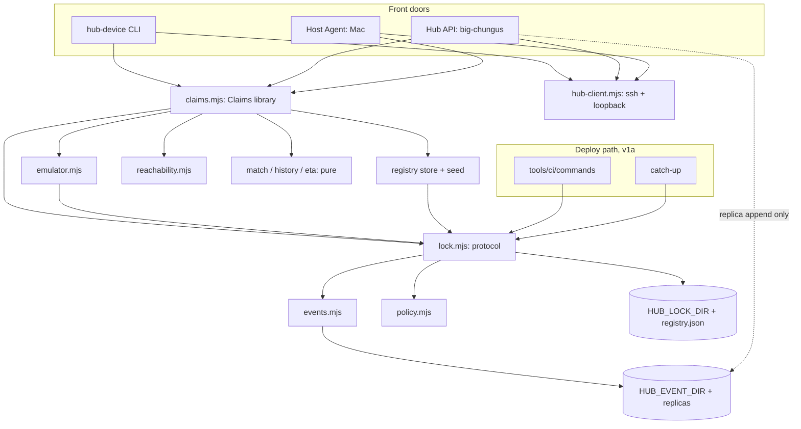
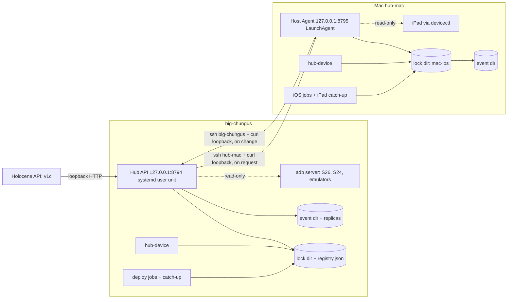

# Architecture Spine: Hub Resource Registry v1b

## Design Paradigm

**A hub-and-spoke control plane over the v1a file-system protocol.** The v1a paradigm stands unchanged underneath: `lock.mjs` owns every protocol path and the on-disk layout is the inter-version contract (AD-1, AD-2). v1b adds two long-lived services and one shared library on top of it, never beside it.

- **Disk is the only state.** Holds, queues, Reservations, the Registry and the Event Log live in files. The Hub API (hub, on big-chungus) and the Host Agent (spoke, on every other host, the Mac in v1b) hold only caches and process-bound waits. Restarting either loses nothing that was written.
- **Each host acts on its own disk.** An action on a Resource runs on that Resource's host, through the Claims library, in-process. The hub routes; it never writes a remote lock dir.
- **One library, three front doors.** `hub-device`, the Hub API and the Host Agent call the same Claims library, so the CLI and the API cannot drift. Deploy jobs and the catch-up keep calling `lock.mjs` directly and never depend on anything v1b adds.

| Layer | Lives in | May import |
| --- | --- | --- |
| Protocol (v1a, extended) | `tools/ci/lib/lock.mjs` | `events.mjs`, `policy.mjs`, `node:` builtins |
| Event Log (v1a, extended) | `tools/ci/lib/events.mjs` | `receipt.mjs` (`hubRef`), `node:` builtins |
| Pure functions | `tools/ci/lib/eta.mjs`, `tools/registry/match.mjs`, `tools/registry/history.mjs` | nothing; data comes in as arguments |
| Registry store (read: anyone; write: Hub API only) | `tools/registry/store.mjs`, `tools/registry/seed.mjs` | `lock.mjs` (atomic helper, `RESERVED`), `tools/ci/lib/devices.mjs`, `policy.mjs` |
| Reachability and discovery (read-only device transports) | `tools/registry/reachability.mjs` | `tools/ci/lib/adb*.mjs` read-only helpers, `node:` builtins |
| Claims library | `tools/device/claims.mjs` | `lock.mjs`, `emulator.mjs`, `eta.mjs`, `tools/registry/*`, `tools/hub-client.mjs` |
| Front doors | `tools/device/hub-device.mjs` (CLI), `tools/hub-api/*.mjs`, `tools/host-agent/*.mjs` | `claims.mjs`, `tools/registry/*`, `events.mjs` (read), `tools/hub-client.mjs` |
| Deploy path (v1a, unchanged) | `tools/ci/commands/*.mjs`, `tools/catchup/*.mjs` | `lock.mjs`, `eta.mjs`, `policy.mjs`; never anything in this table added by v1b |

## Inherited Invariants

All 22 decisions of the v1a spine bind v1b read-only, by their original ids. v1b ADs build on them; none reopens one.

| Inherited | From parent | Binds here |
| --- | --- | --- |
| AD-1 One protocol owner [ADOPTED] | v1a spine | The Hub API, Host Agent and Claims library never mutate a protocol path; they call `lock.mjs`. New writers (`forceRelease`, `cancelRequest`, the Registry's atomic write) are `lock.mjs` exports. |
| AD-2 Layout versioned and additive | v1a spine | `registry.json`, the replica dir and every new record field carry `format: 1` and are additive; pinned readers ignore them. |
| AD-3 Ticket format v1, frozen | v1a spine | API and Pool tickets are ordinary v1 tickets (`kind: lease`, `pool`, `request`); nothing writes `kind: remote` in v1b. |
| AD-4 Queue scope is the Queued set | v1a spine | AD-29 grows the set by name only; one Pool-level event pair per request stays. |
| AD-5 Coded timeouts keep today's wording | v1a spine | API refusals carry the same `HUB_LOCK_TIMEOUT` text in `detail`. |
| AD-6 One queue view | v1a spine | `statusView` (AD-41) calls `queueView`; nothing recomputes place or blocking. |
| AD-7 Reservations are directories | v1a spine | Cancel and force-release of a Reservation go through `lock.mjs`; the `announce` ssh path stays as it is. |
| AD-8 Same-host identity uses a machine id | v1a spine | `host_id` keys the replica dir and the event id (AD-39, AD-40). |
| AD-9 Event Log exactly once, never fatal | v1a spine | Only `lock.mjs` calls `appendEvent`; status reads stay read-only; prune writes its event (AD-39). |
| AD-10 hub_version has one source | v1a spine | `/health.hub_version` and every service event use `hubRef`. |
| AD-11 Queue tuning is policy | v1a spine | v1b tuning goes in strict `policy.json` blocks the same way (AD-46). |
| AD-12 Wait deadline for deploy jobs | v1a spine | Untouched; API waits are bounded by the caller's `wait` and the connection (AD-37). |
| AD-13 Device reads never start or reconnect adb | v1a spine | Reachability and discovery use only the read-only transports (AD-35). |
| AD-14 Contention goes pending on Android | v1a spine | Untouched; the deploy path ignores v1b. |
| AD-15 The catch-up queues as a hub job | v1a spine | Hub jobs cannot be force-released or cancelled through v1b (AD-38). |
| AD-16 Expiry only moves later through `extendLease` | v1a spine | The override (AD-38) is an `extendLease` option; no other path moves expiry. |
| AD-17 The CLI only grows | v1a spine | New verbs (`extend`, `cancel`, `registry …`) and new `--json` fields are additive; exits stay 75, 76, 1, 2, 127, 128+N. |
| AD-18 The ETA is a pure function | v1a spine | The API serves `eta.mjs` output; it never computes its own. |
| AD-19 No new clock [ADOPTED] | v1a spine | Services react to file events, device events and requests; no timers, no polling (AD-43, AD-35). |
| AD-20 The freeze set ships together | v1a spine | Satisfied; v1b changes nothing in the freeze set. |
| AD-21 The Queue replaces lane concurrency groups [ADOPTED] | v1a spine | Untouched. |
| AD-22 iOS contention is red [ADOPTED] | v1a spine | Untouched; `lease ipad|mac` joins the same `mac-ios` queue. |
| Conventions (error `.code`, log markers, ISO UTC, ids, event shape, atomic helper, seams, tests, liveness cost) | v1a spine | Bind every v1b module; extended, never replaced, in Consistency Conventions below. |

## Invariants & Rules



Arrows mean "may import or write". Nothing points back up, and nothing in the deploy path points into v1b. The one write outside `lock.mjs` is the replica append (AD-40), which is not a protocol path.

### AD-23: Disk is the only state; services are stateless

- **Binds:** Hub API, Host Agent, FR-23, NFR-1
- **Prevents:** an in-memory Hold, queue or Registry that a restart loses, or a second store of Holds that disagrees with the lock dir.
- **Rule:** Every Hold, ticket, Reservation, Registry entry and event is a file written through `lock.mjs` (the replica, AD-40, is the one service-written file). A service may keep only caches it can rebuild from disk or a Host Agent (status snapshot, Reachability readings) and waits bound to an open connection. A service starts with no state beyond what it reads.

### AD-24: One Claims library

- **Binds:** `hub-device`, Hub API, Host Agent, FR-21, FR-22, NFR-1
- **Prevents:** the CLI and the API taking, refusing or reporting the same action differently.
- **Rule:** `tools/device/claims.mjs` owns resolve (word or id to Resource), take (Lease, Pool request, emulator), release, cancel, extend, force-release, status assembly, Lease id minting, bounds checks (48 h, the 60 min deploy-target cap) and the code-to-exit table as exported data. `hub-device.mjs` keeps argument parsing and output only. The Hub API and Host Agent map a library error to HTTP through the same table. No front door re-implements any of these.

### AD-25: Actions run on the Resource's host; the deploy path never depends on v1b

- **Binds:** Hub API, Host Agent, Claims library, FR-12, FR-13, FR-22
- **Prevents:** one host writing another host's lock dir, and a deploy failing because a service is down.
- **Rule:** The Registry's `host` field decides where an action runs. On that host it runs in-process in whichever front door received it; from another host it is forwarded to that host's front door (big-chungus: the Hub API; the Mac: the Host Agent). `tools/ci/commands/*` and `tools/catchup/*` never import `claims.mjs`, `tools/registry/*`, `tools/hub-api/*`, `tools/host-agent/*` or `hub-client.mjs`, and never call a service. A conformance test asserts the import rule.

### AD-26: Loopback-only services; cross-host calls are ssh plus loopback

- **Binds:** Hub API, Host Agent, `hub-client.mjs`, NFR-6, NFR-8
- **Prevents:** a service listening on the LAN or tailnet, a second transport per caller, and a Mac that streams while asleep.
- **Rule:** Every service binds `127.0.0.1` only (ports in AD-46). A cross-host call is made by `hub-client.mjs` alone: `ssh -T -o BatchMode=yes <alias> curl -sS --max-time <s> -X <method> http://127.0.0.1:<port><path>` with the JSON body on stdin, where `<alias>` is `devices.json` `mac.host` (from big-chungus) or `linux.host` (from the Mac). Same-host calls use `fetch` to loopback. The Host Agent calls the Hub API only when something on its host changed (a write in its lock or event dir, a Reachability change) or at its own start; the Hub API calls a Host Agent only to serve a request. A failed push is not retried on a timer; the next change, or the next request that needs the host, carries it.

### AD-27: The Registry store has one writer

- **Binds:** Registry, Hub API, `hub-device`, FR-1, FR-2, FR-3
- **Prevents:** two writers racing `registry.json`, a lost edit, and a CLI that breaks when the API is down.
- **Rule:** The Registry is `<HUB_LOCK_DIR>/registry.json` on big-chungus: mode `0600`, `{format: 1, rev, resources: [...], pools: [...]}`, additive. Only the Hub API writes it, serialised in-process, through `lock.mjs`'s exported atomic helper (tmp plus rename). Every write names the `rev` it read (`if_rev`); a mismatch is refused `HUB_REGISTRY_CONFLICT` and `rev` increments by one per write. Readers (`hub-device`, the Claims library) read the file from disk each call. A missing file means the seed derived in memory from `devices.json`; an unknown `format` means the same fallback plus one `HUB_REGISTRY_FORMAT` warning. Registry writes while the API is down fail with `HUB_API_DOWN` (exit 1); Holds are unaffected.

### AD-28: Resource identity is immutable; one reserved-word list

- **Binds:** Registry, Claims library, `hub-device`, `devices.mjs`, FR-1, FR-2, FR-3
- **Prevents:** a rename moving a Resource onto another lock, two lists of reserved words, and a seeded Resource changing its lock.
- **Rule:** A Resource's `id` and `lock` never change after creation. Seeded Resources have fixed ids, locks and names: `s26` (lock `adb`), `s24` (lock `s24`), `ios-lane` (lock `mac-ios`, words `ipad` and `mac`), the emulator Pool (gate `emulator`, slots `emulator-<n>`). A runtime Resource gets `id = lock = res-<slug>`; only its `name` (its CLI word) and Capabilities are editable. `lock.mjs` exports one frozen `RESERVED` list (the CLI words, every internal lock name, `s3-*`, `emulator-<n>`, `emulator-reaper`, `registry`, `hub-api`, `host-agent`); `devices.mjs`, the Registry and the CLI all check names against it. A duplicate identity (serial, UDID) is checked against non-retired Resources and refused with the holder's id.

### AD-29: Queued-ness is decided by name, never by the Registry

- **Binds:** `lock.mjs` `isQueued`, AD-4
- **Prevents:** a lock flipping between queued and bare as the Registry changes, and `lock.mjs` reading a file it does not own.
- **Rule:** `isQueued(name)` is true for the frozen v1a `QUEUED` set, `emulator-<n>`, and `res-<slug>`. `lock.mjs` never reads `registry.json`. Every lock the Registry can mint is therefore Queued from its first use, which is how v1b fulfils AD-4's "the Registry replaces its source, not its role". A retired Resource stays Queued.

### AD-30: Seeding from the committed declarations; private QA data stays private

- **Binds:** `tools/registry/seed.mjs`, Hub API start, FR-3, FR-6, FR-29
- **Prevents:** a Registry edit moving a deploy target, a second copy of `devices.json` drifting, and QA serials leaking into a committed file or a response.
- **Rule:** At every start the Hub API seeds from its own release's `devices.json`: the deploy targets (Android to `adb`, iOS to `mac-ios`), the phones and the hosts. A seeded Resource's identity, lock, name and `deploy_target` are overwritten each start; its Capability edits are kept. A test asserts `lock.mjs`'s `DEPLOY_TARGETS` equals the set derived from `devices.json`. `~/.config/mobile-deploy-hub/qa-devices.json` is read only when `registry.json` is first created: each phone it names gets Capability `dedicated_qa`, and a phone absent from `devices.json` is added with its serial. `allowed_users` is never imported. Every API response, stream payload and status view omits `serial` and `udid` for a `dedicated_qa` phone.

### AD-31: Retirement is stored; visibility is computed

- **Binds:** Registry, Claims library, `statusView`, FR-2
- **Prevents:** a retire that ends a Hold, a Resource that never leaves, and a re-seed that revives it.
- **Rule:** Retiring sets `retired_at` and touches nothing in the lock dir. Readers compute visibility: a retired Resource that is held or queued shows as `retiring`; otherwise it is hidden. The Claims library refuses every new take on it with `HUB_RESOURCE_RETIRED` (exit 2), whichever front door asked. It stays in `registry.json` and in the Event Log, and seeding never clears `retired_at`. Seeded Resources cannot be retired or have identity edited (`HUB_REGISTRY_SEEDED`, exit 2).

### AD-32: Resolution off big-chungus goes through the Hub API

- **Binds:** `hub-device` on the Mac, Host Agent, Claims library, FR-1, FR-12, FR-13
- **Prevents:** a Mac-side copy of the Registry that a second writer must keep in sync.
- **Rule:** Only big-chungus reads `registry.json`. On any other host, `hub-device` and the Host Agent resolve a word or capability request by asking the Hub API through `hub-client.mjs`; when the API cannot be reached they resolve from the in-memory `devices.json` seed only. A forwarded action carries the resolved Resource record, so the receiving front door never re-resolves. From big-chungus, an action on a Mac Resource with the Mac unreachable fails at once `HUB_DEVICE_AWAY` (exit 75, reason `host-unreachable`); with the Hub API down, `hub-device` on big-chungus forwards to the Mac directly through `hub-client.mjs`.

### AD-33: One matcher; Pool requests queue in every member

- **Binds:** `tools/registry/match.mjs`, Claims library, `lock.mjs` Pool request, FR-6, FR-13
- **Prevents:** two definitions of "matches", a Pool request that loses its place by polling members one at a time, and per-member event noise.
- **Rule:** `match(registry, request)` is pure and the only matcher. A Pool is either a seeded named list in preference order (`phone = [s24, s26]`) or a Capability query; a query excludes retired and `dedicated_qa` Resources unless it names them or asks for `dedicated_qa`. All candidates of one request share one host; a cross-host match is refused `HUB_POOL_CROSS_HOST` (exit 2). The request writes the identical ticket file name into every candidate's queue, takes the first that serves it, and withdraws the other tickets without an event; the Event Log gets one Pool-level `request` and one `acquire`, `timeout` or `cancel` (AD-4). The emulator Pool keeps its `emulator` gate; profile is a Capability. No match fails at once (`HUB_NO_MATCH`, exit 2); every match `offline`, `absent` or `unauthorized` fails at once (`HUB_DEVICE_AWAY`, exit 75).

### AD-34: "Others waiting" covers every queue a Resource is served from

- **Binds:** `lock.mjs` `extendLease`, FR-31, AD-16
- **Prevents:** an emulator slot or Pool member being extended while a waiter sits in a queue the check does not read.
- **Rule:** `extendLease`'s waiter check reads the Resource's own queue (which holds Pool tickets, AD-33) and, for an `emulator-<n>` slot, the `emulator` gate queue. The refusal names every waiter with its position, as v1a does.

### AD-35: Reachability has one enum, one owner per host, and read-only transports

- **Binds:** `reachability.mjs`, Host Agent, Hub API, FR-4, FR-5, FR-12
- **Prevents:** a status read starting adb, two mappings from presence to state, the API guessing a Mac reading, and a reading passed off as current.
- **Rule:** Reachability is `reachable | unauthorized | offline | absent | unknown`, mapped from device presence by one function in `reachability.mjs`. Each host's front door (big-chungus: the Hub API; the Mac: the Host Agent) is the only one that reads its own devices, using only the read-only transports (`host:devices` and `host:track-devices` on the adb wire, or `adb -L tcp:127.0.0.1`; `devicectl` list on the Mac), never `findPhone`, never a server start or connect. Readings are cached with `checked_at` and served with their age; a reading older than `registry.reachability_max_age_s` is refreshed once on request (concurrent requests share one refresh) and flagged `stale` meanwhile. A host the Hub API cannot reach makes every Resource on it read `offline`. Each change appends one `reachability` event on the reading host; the Hub API appends `host-reachability` when a Host Agent comes or goes. Discovery (FR-4) lists devices the same transport sees that no Resource names, and reports `no adb server` rather than starting one. `unauthorized` keeps exit 75, as today.

### AD-36: API Leases are lock-only and expiry-bound

- **Binds:** Claims library, Hub API, Host Agent, `acquireLease`, `provision`, FR-10, FR-22
- **Prevents:** an API Lease being reclaimed because the service restarted, an API Lease run through `findPhone`, and service env leaking a deploy identity into a record.
- **Rule:** A Lease taken through a service has `holderPid: null` and lasts until its `expires_at` or its release. It never calls `findPhone`. The service's environment carries no `GITHUB_*` variable. `holder`, `why` and the claimant kind come from the caller and are recorded as given; `acquireLease` gains a `claimantKind` option (`agent` default, or `person`). An emulator Lease through a service calls `provision({holderPid: null})` off the request path (AD-44).

### AD-37: Waits through a service are bound to the connection

- **Binds:** Hub API, Host Agent, FR-23
- **Prevents:** a ghost waiter holding a place for a client that left, a Hold granted to nobody, and a silent drop on restart.
- **Rule:** A waiting request keeps its HTTP connection open; its ticket carries the serving process's pid. When the client disconnects the wait is aborted and `lock.mjs` records `cancel`. A Hold granted after the client left is released at once. On `SIGTERM` the service answers every open wait `503 HUB_API_RESTARTING` with `retry: requeue`, aborts its tickets, then exits. After a crash the tickets are stale by pid and the next pruner removes them with a `prune` event. A forwarded wait is the same chain end to end: if the ssh leg dies, the far end sees its client disconnect.

### AD-38: Force-release, cancel and override are `lock.mjs` functions

- **Binds:** `lock.mjs`, Claims library, FR-10, FR-11, FR-31, AD-15, AD-16
- **Prevents:** a front door deleting lock files itself, ending a Job Hold from outside its run, or an override that bypasses expiry limits.
- **Rule:** `lock.mjs` exports `forceRelease(name, {actor, why})`, which renames the owner to a tomb, writes `force-release`, and refuses a `job` or `hub-job` owner with `HUB_FORCE_RELEASE_JOB` (exit 2); and `cancelRequest(name, id, opts)` (opts carries `actor`), which removes a ticket or the caller's own Reservation and never touches a Hold, and refuses a job ticket. `extendLease` gains `override: {actor, why}`, which skips only the waiters check, never the expiry check, the 48 h limit or the 60 min deploy-target cap. Events gain additive `actor: {holder, via}` and `why`. Force-releasing an `emulator-<n>` slot then runs `releaseEmulator`'s teardown.

### AD-39: Event Log additions keep one appender and gain ids

- **Binds:** `lock.mjs`, `events.mjs`, every event reader, FR-14, FR-17, FR-18, AD-9
- **Prevents:** a second appender, readers that cannot resume, and v1a's prune drift.
- **Rule:** New event names: `registry-add`, `registry-edit`, `registry-retire`, `reachability`, `host-reachability`, `prune`, `force-release`; an override is recorded on `extend` with `actor` and `why`. Non-hold events are appended only through new `lock.mjs` functions (`noteRegistry`, `noteReachability`), so `lock.mjs` stays the only `appendEvent` caller. Pruning a ticket or Reservation now writes one `prune` event and removes with `unlinkSync`, as AD-9 already says. An event's id is `<host_id>/<YYYY-MM>/<byte offset>`, derived on read. `events.mjs` gains one cursor reader, `readEventsFrom(cursor)`, used by the stream, the replica and history; nothing else tails the log.

### AD-40: Remote history is a read-only replica, filled by push

- **Binds:** Hub API, Host Agent, FR-18, NFR-8
- **Prevents:** a merged log that rewrites history, a Mac log that is only readable when the Mac is awake, and duplicate lines after a retry.
- **Rule:** Each host's own Event Log is authoritative. The Hub API keeps `HUB_EVENT_DIR/replicas/<host_id>/<YYYY-MM>.jsonl` for each remote host, appended only by the Hub API from Host Agent pushes that carry a cursor; a push is idempotent by offset, and `lock.mjs` never writes there. A history request that needs a reachable host pulls the missing range first. History merges the local log with the replicas ordered by `ts` then host; a response covering a range the replica lacks while the host is unreachable is `partial: true` with `synced_through` per host. Utilisation (held, idle while reserved, idle, away) is a pure function in `history.mjs` over those events; time before the first `reachability` event for a Resource counts as `unknown`, not idle.

### AD-41: One status builder; remote views are rendered by their own host

- **Binds:** Claims library, `hub-device status --json`, Hub API `/status`, Host Agent snapshot, FR-14, FR-29
- **Prevents:** the CLI and the API showing different queues, and a queue position computed on another host's clock.
- **Rule:** `statusView(host)` in the Claims library produces the per-host document for `hub-device status --json`, the Host Agent snapshot and the Hub API. The API's `/status` embeds each host's view unchanged and adds only additive keys (`registry`, `reachability`, `hosts`, `stale`, `checked_at`). Deploy targets are marked from the seed. The API never recomputes a remote queue or a remote ETA. `hub-device status` on big-chungus adds remote hosts from the API when it answers, otherwise lists them as `unavailable`; it stays read-only.

### AD-42: The Hub API contract follows the Candybar house pattern

- **Binds:** `docs/hub-api-contract.md`, Hub API, v1c Holocene module, FR-21
- **Prevents:** Holocene coding against undocumented shapes, and two error envelopes.
- **Rule:** `docs/hub-api-contract.md` in this repo is the contract: a `Status:` line with the contract version, dated additive annotations, no path prefix. `GET /health` returns `{ok, service, contract, hub_version}`. Errors are `application/problem+json` `{type, title, status, detail}` plus `code`, `exit` and `reason`. Every write returns the resulting state. Every response is `Cache-Control: no-store`. A `node --test` contract test parses the markdown field lists and asserts exact key sets against handler output. A field is only ever added; removing or renaming one is a new contract version.

### AD-43: One stream, Candybar wire, change-driven

- **Binds:** Hub API `GET /stream`, Host Agent pushes, FR-14, NFR-3
- **Prevents:** a second wire format for Holocene, polling, and trusting a partial file event.
- **Rule:** `GET /stream` speaks the Candybar SSE wire: `retry: 3000`; `ready` (or `reset` when the client's `Last-Event-ID` is unknown) first; `id: <boot>-<seq>`; one-line JSON payloads with `type`, `seq`, `key`, `at` and the absolute state. Types are `status` (the whole `/status` document, coalesced) and `event` (one Event Log line with its id). A `: keepalive` comment goes out at most every `api.stream_keepalive_s`. Changes come from `fs.watch` on the local lock and event dirs and from Host Agent pushes; any notification means "re-read", never "trust the filename". Nothing polls.

### AD-44: Reads never wait on scans or devices

- **Binds:** Hub API, Host Agent, NFR-7
- **Prevents:** a status read blocking on `/proc` scans, adb or an emulator boot.
- **Rule:** `/status`, `/stream` and every read endpoint answer from the in-memory snapshot. `/proc` scans, emulator `inventory()`, adb queries and `provision` run in a `node:worker_threads` worker or in the action handler that needs them, and update the snapshot when done.

### AD-45: Service lifecycle and roll-out

- **Binds:** `install.sh`, `tools/hosts.mjs`, the unit files, NFR-2, NFR-3
- **Prevents:** two Hub APIs, a service following `current` mid-release, a stop that kills running emulators, and a second schedule.
- **Rule:** The singleton is the port bind: `EADDRINUSE` exits 1 with `HUB_API_ALREADY_RUNNING`; no lock-dir singleton. Both services run from `releases/<ref>` with the absolute mise `node/24` path and switch only at `hosts:install`. On big-chungus, the systemd user unit `mobile-deploy-hub-api.service` (`Type=simple`, `Restart=on-failure`, `KillMode=process`) is copied by `install.sh` (which still runs only `daemon-reload`) and enabled, restarted and read back through `/health` by `hosts.mjs`. On the Mac, the LaunchAgent `sh.delo.mobile-deploy-hub.host-agent` (`KeepAlive`, `RunAtLoad`, `LimitLoadToSessionType Aqua`, no `StartInterval`) is bootstrapped by `install.sh`'s Darwin branch; the catch-up label and plist are untouched. `hosts:install` never deletes the release dir a running service uses. Neither service adds a timer.

### AD-46: v1b tuning lives in strict policy blocks

- **Binds:** `policy.json`, `policy.mjs`, every v1b module
- **Prevents:** a port or freshness limit read from env, an app or an input, and tests depending on host config.
- **Rule:** `policy.json` gains `registry: {reachability_max_age_s: 60}` and `api: {hub_api_port: 8794, host_agent_port: 8795, stream_keepalive_s: 15}`, parsed strictly like AD-11's `queue` block. Modules take `policy` as a seam; tests inject it.

## Consistency Conventions

| Concern | Convention |
| --- | --- |
| New error codes | `HUB_REGISTRY_CONFLICT` (409, exit 1), `HUB_REGISTRY_SEEDED` (409, exit 2), `HUB_REGISTRY_FORMAT` (warning only), `HUB_RESOURCE_RETIRED` (409, exit 2), `HUB_NO_MATCH` (404, exit 2), `HUB_POOL_CROSS_HOST` (400, exit 2), `HUB_FORCE_RELEASE_JOB` (409, exit 2), `HUB_API_DOWN` (exit 1), `HUB_API_RESTARTING` (503, exit 1, `retry: requeue`), `HUB_API_ALREADY_RUNNING` (exit 1). Away is 503 exit 75, busy 409 exit 76, as the Claims table maps them. |
| HTTP | JSON bodies, `snake_case` keys (as the Event Log), problem+json errors, `Cache-Control: no-store`, no path prefix. Writes are `POST` on a noun (`/leases`, `/leases/<id>/extend`, `/requests/<id>/cancel`, `/registry/resources`); reads are `GET`. |
| Registry record | `{id, lock, name, kind: phone\|ios-lane\|emulator-pool\|emulator\|host, host, identity: {serial?, udid?, profile?}, capabilities: {...}, deploy_target: bool, seeded: bool, created_at, retired_at?}`. Capabilities are flat `snake_case` keys with scalar values. |
| Actor | Every manual action records `actor: {holder, via: cli\|api\|control-surface}` as given by the caller. |
| Service log lines | v1a markers plus `HUB_API_LISTEN`, `HUB_API_STOP`, `HUB_AGENT_PUSH`, `HUB_AGENT_PUSH_FAILED`, `HUB_REACHABILITY`, then `key=value`. |
| Seams | v1a's set plus `fetchImpl`, `sshImpl` (the `hub-client` transport) and `watchImpl`. Nothing opens a socket, spawns ssh or watches a dir without the seam. |
| Tests | `node --test`, `hermetic()`, temp lock and event dirs; services tested by calling their handler with injected seams, never by binding a real port in the shared suite. One test per AD Rule, plus the contract test. |

## Stack

| Name | Version |
| --- | --- |
| Node.js | >= 24 (24.22.3 newest 24.x, Maintenance LTS); services run on the mise `node/24` path (24.15.0 on both hosts today) |
| HTTP, SSE, file watch, workers | `node:http`, `fs.watch` (inotify on Linux, FSEvents on macOS), `node:worker_threads`; no library |
| Dependencies | none (`node:` builtins only) |
| Cross-host transport | OpenSSH aliases `hub-mac` and `big-chungus` (existing), `curl` on both hosts |
| Service managers | systemd user units on big-chungus (linger on); launchd per-user LaunchAgent on the Mac |
| Device transports | adb wire `host:devices` and `host:track-devices` (read-only); `xcrun devicectl` list on the Mac |

## Structural Seed

```text
tools/
  ci/lib/lock.mjs              # + RESERVED, isQueued(res-*), forceRelease, cancelRequest, extendLease override,
                               #   claimantKind, noteRegistry, noteReachability, exported atomic write
  ci/lib/events.mjs            # + readEventsFrom(cursor)
  ci/policy.json               # + registry, api blocks
  device/claims.mjs            # Claims library (from hub-device internals)
  device/hub-device.mjs        # CLI: parse + print; new verbs extend, cancel, registry
  hub-client.mjs               # same-host fetch or ssh + loopback curl
  registry/{store,seed,match,reachability,history}.mjs
  hub-api/{server,routes,stream,replica,worker}.mjs
  host-agent/{server,watch,push}.mjs
  hosts/mobile-deploy-hub-api.service
  hosts/sh.delo.mobile-deploy-hub.host-agent.plist
docs/hub-api-contract.md
HUB_LOCK_DIR/registry.json                    # big-chungus only (AD-27)
HUB_EVENT_DIR/replicas/<host_id>/<YYYY-MM>.jsonl   # big-chungus only (AD-40)
```



**Roll-out (NFR-2):** one hub release ships the `lock.mjs` additions, the Claims library, both services and the units; `hosts:install` on both hosts switches `hub-device` and both services together. Deploy jobs and the catch-ups need nothing from v1b and keep working on every pin. Pinned readers ignore `registry.json`, `replicas/` and the new event names. A runtime Resource is holdable by `hub-device` within 60 s of registration once that install has shipped (FR-1).

## Capability → Architecture Map

| Capability | Lives in | Governed by |
| --- | --- | --- |
| FR-1 Register a Resource | Hub API, `store.mjs` | AD-27, AD-28, AD-29, AD-32 |
| FR-2 Edit and retire | Hub API, `store.mjs`, Claims library | AD-27, AD-28, AD-31 |
| FR-3 Seed and re-sync | `seed.mjs`, Hub API start | AD-28, AD-30 |
| FR-4 Discover unregistered devices | `reachability.mjs`, Hub API, Host Agent | AD-35 |
| FR-5 Reachability | `reachability.mjs`, Host Agent, Hub API | AD-26, AD-35, AD-46 |
| FR-6 Find by Capability | `match.mjs`, Claims library, `lock.mjs` | AD-33, AD-34 |
| FR-29 Deploy targets visible | `seed.mjs`, `statusView` | AD-30, AD-41 |
| FR-10 Leases through the API | Claims library, Hub API, Host Agent | AD-24, AD-36, AD-37, AD-16 |
| FR-11 Cancel and force-release | `lock.mjs`, Claims library | AD-38, AD-7, AD-15 |
| FR-12 `ios-lane`, `lease ipad\|mac` | Host Agent, Claims library, `hub-client.mjs` | AD-25, AD-26, AD-32, AD-35 |
| FR-14 Live status and stream | `statusView`, Hub API stream | AD-41, AD-43, AD-44 |
| FR-18 History and utilisation | `events.mjs`, replica, `history.mjs` | AD-39, AD-40 |
| FR-21 Endpoints and contract | Hub API, `docs/hub-api-contract.md` | AD-42 |
| FR-22 Same semantics as the CLI | Claims library | AD-24, AD-25 |
| FR-23 Survive restarts | services | AD-23, AD-37, AD-45 |
| NFR-1 One implementation | `lock.mjs`, Claims library | AD-1, AD-23, AD-24 |
| NFR-2 Pinned runs | release, `hosts:install` | AD-2, AD-25, AD-29, AD-45 |
| NFR-3 No new clock | services | AD-19, AD-26, AD-43, AD-45 |
| NFR-6 Reach and access | services, `hub-client.mjs` | AD-26 |
| NFR-7 Latency | Hub API | AD-44 |
| NFR-8 The Mac is a laptop | Host Agent | AD-26, AD-40 |

## Open Questions

1. **v1c Holocene module id and env var.** `/api/modules/hub` is taken and `HUB_*` env names collide inside Holocene. The contract proposes module id `mobile-deploy-hub` and `MOBILE_DEPLOY_HUB_API_URL` (default `http://127.0.0.1:8794`). Non-blocking for v1b.
2. **Do person Leases count toward Lease ETA history?** v1a's ETA matches history by claimant kind, so `person` history stays separate until Jarad decides.

## Deferred

- **v1c Capacity Estimate and starvation signal (FR-19, FR-20):** consume `/history` and `history.mjs` utilisation; the contract reserves `GET /capacity` and adds it then. Nothing in v1b computes it.
- **v1c Control Surface (Holocene page):** reads `/status` and `/stream` server-side and forwards the narrow writes (Lease, extend with override, cancel, force-release with confirmation, registry edits) through the same endpoints, with `actor.via: control-surface`. v1b ships the endpoints and the contract; the confirmation step for force-release lives in the page.
- **v2 remote waiting:** tickets with `kind: remote`, Heartbeats and fencing (AD-3 reserves them). v1b waits stay connection-bound.
- **Runtime emulator profiles beyond installed images, and a Registry-driven `MAX_POOL`:** `PROFILES` and `MAX_POOL` stay code constants; a profile may be registered only when its system image is installed.
- **More hosts with a Host Agent:** the design takes any `devices.json` host alias; only the Mac runs one in v1b.
- **Authentication on loopback:** none; the actor is recorded as given (NFR-6). Revisit if anything but Holocene and local agents reaches the API.
- **Event Log rotation and compaction (replicas included):** when the log passes 100 MB, as in v1a.
