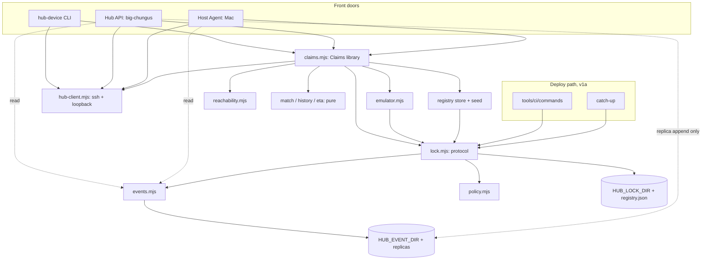
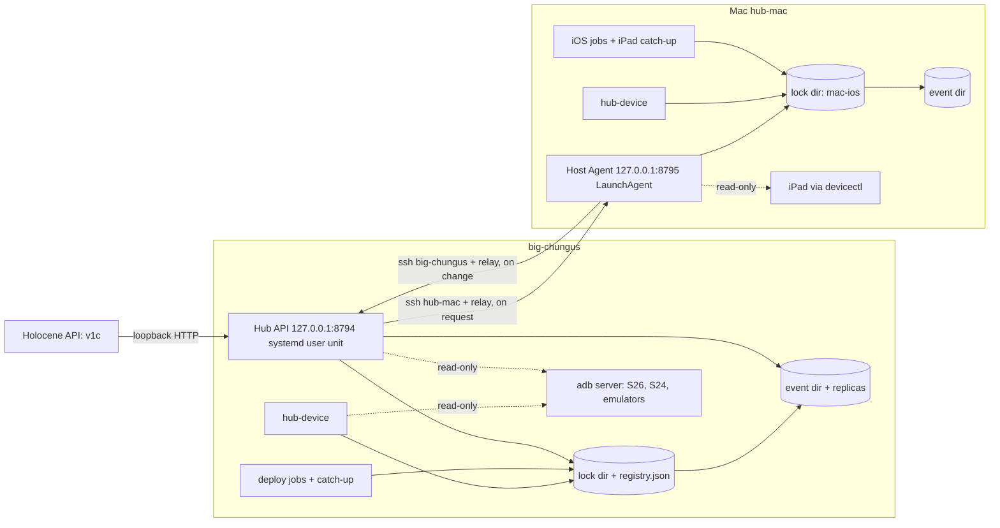

# Architecture Spine: Hub Resource Registry v1b

## Design Paradigm

**A hub-and-spoke control plane over the v1a file-system protocol.** The v1a paradigm stands unchanged underneath: `lock.mjs` owns every protocol path and the on-disk layout is the inter-version contract (AD-1, AD-2). v1b adds two long-lived services and one shared library on top of it, never beside it.

- **Disk is the only state.** Holds, queues, Reservations, the Registry and the Event Log live in files. The Hub API (hub, on big-chungus) and the Host Agent (spoke, on every other host, the Mac in v1b) hold only caches and process-bound waits. Restarting either loses nothing that was written.
- **Each host acts on its own disk.** An action on a Resource runs on that Resource's host, through the Claims library, in-process. The hub routes; it never writes a remote lock dir.
- **One library, three front doors.** `hub-device`, the Hub API and the Host Agent call the same Claims library, so the CLI and the API cannot drift. Deploy jobs and the catch-up keep calling `lock.mjs` directly and never depend on anything v1b adds.

| Layer | Lives in | May import |
| --- | --- | --- |
| Protocol (v1a, extended) | `tools/ci/lib/lock.mjs` | `events.mjs`, `policy.mjs`, `node:` builtins |
| Event Log (v1a, extended) | `tools/ci/lib/events.mjs` | `receipt.mjs` (`hubRef`), `node:` builtins |
| Pure functions | `tools/ci/lib/eta.mjs`, `tools/registry/match.mjs`, `tools/registry/history.mjs` | nothing; data comes in as arguments |
| Registry store (read: anyone; write: Hub API only) | `tools/registry/store.mjs`, `tools/registry/seed.mjs` | `lock.mjs` (atomic helper, `RESERVED`), `tools/ci/lib/devices.mjs`, `policy.mjs` |
| Reachability and discovery (read-only device transports) | `tools/registry/reachability.mjs` | `tools/device/adb-wire.mjs` (gains a streaming `trackDevices`), `tools/ci/lib/adb.mjs` (the Peek), `tools/ci/lib/devicectl.mjs` (`pickIpad`), `node:` builtins |
| Claims library | `tools/device/claims.mjs` | `lock.mjs`, `emulator.mjs`, `eta.mjs`, `tools/registry/*`, `tools/hub-client.mjs` |
| Front doors | `tools/device/hub-device.mjs` (CLI), `tools/hub-api/*.mjs`, `tools/host-agent/*.mjs` | `claims.mjs`, `tools/registry/*`, `events.mjs` (read), `tools/hub-client.mjs` |
| Deploy path (v1a, unchanged) | `tools/ci/commands/*.mjs`, `tools/catchup/*.mjs` | `lock.mjs`, `eta.mjs`, `policy.mjs`; never anything in this table added by v1b |

## Inherited Invariants

All 22 decisions of the v1a spine bind v1b read-only, by their original ids. v1b ADs build on them; none reopens one.

| Inherited | From parent | Binds here |
| --- | --- | --- |
| AD-1 One protocol owner [ADOPTED] | v1a spine | The Hub API, Host Agent and Claims library never mutate a protocol path; they call `lock.mjs`. New writers (`forceRelease`, `cancelRequest`, the Registry's atomic write) are `lock.mjs` exports. |
| AD-2 Layout versioned and additive | v1a spine | `registry.json`, the replica dir and every new record field carry `format: 1` and are additive; pinned readers ignore them. |
| AD-3 Ticket format v1, frozen | v1a spine | API and Pool tickets are ordinary v1 tickets (`kind: lease`; Pool tickets carry `pool` and `request` fields); nothing writes `kind: remote` in v1b. |
| AD-4 Queue scope is the Queued set | v1a spine | AD-29 grows the set by name only; one Pool-level event pair per request stays. |
| AD-5 Coded timeouts keep today's wording | v1a spine | API refusals carry the same `HUB_LOCK_TIMEOUT` text in `detail`. |
| AD-6 One queue view | v1a spine | `statusView` (AD-41) calls `queueView`; nothing recomputes place or blocking. |
| AD-7 Reservations are directories | v1a spine | Cancel and force-release of a Reservation go through `lock.mjs`; the `announce` ssh path stays as it is. |
| AD-8 Same-host identity uses a machine id | v1a spine | `host_id` keys the event id (AD-39); replica dirs use the host key (AD-47). |
| AD-9 Event Log exactly once, never fatal | v1a spine | Only `lock.mjs` calls `appendEvent`; status reads stay read-only; prune writes its event (AD-39). |
| AD-10 hub_version has one source | v1a spine | `/health.hub_version` and every service event use `hubRef`. |
| AD-11 Queue tuning is policy | v1a spine | v1b tuning goes in strict `policy.json` blocks the same way (AD-46). |
| AD-12 Wait deadline for deploy jobs | v1a spine | Untouched; API waits are bounded by the caller's `wait` and the connection (AD-37). |
| AD-13 Device reads never start or reconnect adb | v1a spine | Reachability and discovery use only the read-only transports (AD-35). |
| AD-14 Contention goes pending on Android | v1a spine | Untouched; the deploy path ignores v1b. |
| AD-15 The catch-up queues as a hub job | v1a spine | Hub jobs cannot be force-released or cancelled through v1b (AD-38). |
| AD-16 Expiry only moves later through `extendLease` | v1a spine | The override (AD-38) is an `extendLease` option; no other path moves expiry. |
| AD-17 The CLI only grows | v1a spine | New verbs (`extend`, `cancel`, `registry …`) and new `--json` fields are additive; exits stay 75, 76, 1, 2, 127, 128+N. |
| AD-18 The ETA is a pure function | v1a spine | The API serves `eta.mjs` output; it never computes its own. |
| AD-19 No new clock [ADOPTED] | v1a spine | Services react to file events, device events and requests and never poll. The only timers are the v1a alive touch, request-bound `lock.mjs` wait loops, one keepalive per open stream connection, one stdin heartbeat per forwarded call, per-request timeouts, bounded retries within one invocation and one-shot debounces, each cleared with its request or connection; a conformance test finds no `setInterval` outside `stream.mjs`, `hub-client.mjs` and `lock.mjs` (AD-43, AD-35, AD-45). |
| AD-20 The freeze set ships together | v1a spine | Satisfied; v1b changes nothing in the freeze set. |
| AD-21 The Queue replaces lane concurrency groups [ADOPTED] | v1a spine | Untouched. |
| AD-22 iOS contention is red [ADOPTED] | v1a spine | Untouched; `lease ipad|mac` joins the same `mac-ios` queue. |
| Conventions (error `.code`, log markers, ISO UTC, ids, event shape, atomic helper, seams, tests, liveness cost) | v1a spine | Bind every v1b module; extended, never replaced, in Consistency Conventions below. |

## Invariants & Rules



Arrows mean "may import or write". Nothing points back up, and nothing in the deploy path points into v1b. The one write outside `lock.mjs` is the replica append (AD-40), which is not a protocol path.

### AD-23: Disk is the only state; services are stateless

- **Binds:** Hub API, Host Agent, FR-23, NFR-1
- **Prevents:** an in-memory Hold, queue or Registry that a restart loses, or a second store of Holds that disagrees with the lock dir.
- **Rule:** Every Hold, ticket, Reservation, Registry entry and event is a file written through `lock.mjs` (the replica, AD-40, is the one service-written file). A service may keep only caches it can rebuild from disk or a Host Agent (status snapshot, Reachability readings) and waits bound to an open connection. A service starts with no state beyond what it reads.

### AD-24: One Claims library

- **Binds:** `hub-device`, Hub API, Host Agent, FR-21, FR-22, NFR-1
- **Prevents:** the CLI and the API taking, refusing or reporting the same action differently.
- **Rule:** `tools/device/claims.mjs` owns resolve (word or id to Resource), take (Lease, Pool request, emulator), release, cancel, extend, force-release, status assembly, Lease id minting, bounds checks (48 h, the 60 min deploy-target cap) and the code-to-exit table as exported data. `hub-device.mjs` keeps argument parsing and output only. The Hub API and Host Agent map a library error to HTTP through the same table. No front door re-implements any of these.

### AD-25: Actions run on the Resource's host; the deploy path never depends on v1b

- **Binds:** Hub API, Host Agent, Claims library, FR-12, FR-13, FR-22
- **Prevents:** one host writing another host's lock dir, and a deploy failing because a service is down.
- **Rule:** The Registry's `host` field decides where an action runs. On that host it runs in-process in whichever front door received it; from another host it is forwarded to that host's front door (big-chungus: the Hub API; the Mac: the Host Agent). `tools/ci/commands/*` and `tools/catchup/*` never import `claims.mjs`, `tools/registry/*`, `tools/hub-api/*`, `tools/host-agent/*` or `hub-client.mjs`, and never call a service. A conformance test asserts the import rule.

### AD-26: Loopback-only services; cross-host calls are ssh plus loopback

- **Binds:** Hub API, Host Agent, `hub-client.mjs`, NFR-6, NFR-8
- **Prevents:** a service listening on the LAN or tailnet, a second transport per caller, and a Mac that streams while asleep.
- **Rule:** Every service binds `127.0.0.1` only (ports in AD-46). A cross-host call is made by `hub-client.mjs` alone: `ssh -T -o BatchMode=yes -o ConnectTimeout=<api.peer_connect_timeout_s> -o ControlMaster=no -o ControlPath=none -o ServerAliveInterval=15 -o ServerAliveCountMax=2 <alias> <remote command>`, where `<alias>` comes from the host key (AD-47) and the remote command runs `hub-client.mjs relay <method> <path>` from the peer's installed release with its absolute node path, every word single-quoted (the `catchup.mjs` escaping) because both login shells are zsh. Never bare curl: sshd does not signal a command whose client vanished, so only the relay sees a disconnect. The JSON body is the relay's first stdin line; `hub-client` then writes one newline every `api.stream_keepalive_s` for the life of the call, and the relay calls the peer's loopback port and aborts that request on stdin EOF or after 3 intervals with no byte (the Mac's sshd sets no `ClientAliveInterval`, so EOF alone can come too late). The relay writes the status, headers and body back; `hub-client` parses them as a `fetch` response and kills ssh at the AD-48 bound plus 10 s. Same-host calls use `fetch` to loopback. A hermetic test runs one route through both transports and compares them, runs a path containing `?`, `&` and `'` through `zsh -c` and `sh -c`, and closes stdin mid-wait to assert a `cancel` event. The Host Agent calls the Hub API only when something on its host changed (a write in its lock or event dir, a Reachability change) or at its own start; the Hub API calls a Host Agent only to serve a request. A failed push is not retried on a timer; the next change, or the next request that needs the host, carries it.

### AD-27: The Registry store has one writer

- **Binds:** Registry, Hub API, `hub-device`, FR-1, FR-2, FR-3
- **Prevents:** two writers racing `registry.json`, a lost edit, and a CLI that breaks when the API is down.
- **Rule:** The Registry is `<HUB_LOCK_DIR>/registry.json` on big-chungus: mode `0600`, `{format: 1, rev, resources: [...], pools: [...]}`, additive. Only the Hub API writes it, serialised in-process, through `lock.mjs`'s exported atomic helper (tmp plus rename). Every write names the `rev` it read (`if_rev`); a mismatch is refused `HUB_REGISTRY_CONFLICT` and `rev` increments by one per write. Readers (`hub-device`, the Claims library) read the file from disk each call. A missing file means the seed derived in memory by `seed.mjs` (the same function AD-30 runs, including the `dedicated_qa` marks from `qa-devices.json`); an unparsable file or an unknown `format` means the same fallback plus one `HUB_REGISTRY_FORMAT` warning, and that file is never written: every write, the seed write included, is refused `HUB_REGISTRY_FORMAT` (409, exit 1) and `/health` reports `registry: unreadable`, so rolling back to an older Hub API cannot overwrite newer records or free their ids. The rename is the deciding step: the writer appends its `registry-*` event right after it, carrying the new `rev`; at start the Hub API compares `rev` with the last logged `rev` and appends one `registry-edit` with `reason: recovered` when the log is behind. Seeding is a write like any other (one `if_rev` write, only when the derived seed differs, `registry-edit` only for records that changed). Registry writes while the API is down fail with `HUB_API_DOWN` (exit 1, "the Hub API is not answering; registry changes are unavailable, holds still work"): the API is down when the connect is refused or `/health` gives no answer within 2 s. A write that timed out after its body was sent is `HUB_API_UNKNOWN` (exit 1), because it may have applied. Holds are unaffected.

### AD-28: Resource identity is immutable; one reserved-word list

- **Binds:** Registry, Claims library, `hub-device`, `devices.mjs`, FR-1, FR-2, FR-3
- **Prevents:** a rename moving a Resource onto another lock, two lists of reserved words, and a seeded Resource changing its lock.
- **Rule:** A Resource's `id` and `lock` never change after creation. Seeded Resources have fixed ids, locks and names: `s26` (lock `adb`), `s24` (lock `s24`), `ios-lane` (lock `mac-ios`, words `ipad` and `mac`), the emulator Pool (gate `emulator`, slots `emulator-<n>`). `lock.mjs` exports `SLUG = /^[a-z0-9]+(-[a-z0-9]+)*$/` (1 to 32 characters; a name is at most 28, so a minted `res-<slug>-<n>`, n ≤ 999, still passes `isQueued`), used by `isQueued`, the store and `RESERVED`. A runtime Resource gets `id = lock = res-<slug>`, or `res-<slug>-<n>` (smallest `n >= 2`) when any record, retired included, already uses that id; ids and locks are never reused. Only its `name` (its CLI word) and Capabilities are editable. Names are unique across every record, retired included. `lock.mjs` exports one frozen `RESERVED` list (the CLI words, every internal lock name, `s3-*`, `emulator-<n>`, `emulator-reaper`, `registry`, `hub-api`, `host-agent`, and the id shapes `res-*`, `l-*`, `e-*`, `job:*`); resolution tries an id first, then a name; `devices.mjs`, the Registry and the CLI all check names against it. A duplicate identity (serial, UDID) is checked against non-retired Resources and refused with the holder's id; a retired identity may be registered again as a new Resource. A `kind: phone` record stores `identity.model` (required; `findPhone` checks it). A Resource's `host` is a host key (AD-47) and never changes.

### AD-29: Queued-ness is decided by name, never by the Registry

- **Binds:** `lock.mjs` `isQueued`, AD-4
- **Prevents:** a lock flipping between queued and bare as the Registry changes, and `lock.mjs` reading a file it does not own.
- **Rule:** `isQueued(name)` is true for the frozen v1a `QUEUED` set, `emulator-<n>`, and `res-<slug>`. `lock.mjs` never reads `registry.json`. Every lock the Registry can mint is therefore Queued from its first use, which is how v1b fulfils AD-4's "the Registry replaces its source, not its role". A retired Resource stays Queued.

### AD-30: Seeding from the committed declarations; private QA data stays private

- **Binds:** `tools/registry/seed.mjs`, Hub API start, FR-3, FR-6, FR-29
- **Prevents:** a Registry edit moving a deploy target, a second copy of `devices.json` drifting, and QA serials leaking into a committed file or a response.
- **Rule:** At every start the Hub API seeds from its own release's `devices.json`: the deploy targets (Android to `adb`, iOS to `mac-ios`), the phones and the hosts. A seeded Resource's identity, lock, name and `deploy_target` are overwritten each start; its Capability edits are kept. A seeded Resource missing from the new `devices.json` is kept and marked `seed_missing: true`; it is shown only while held or queued, new takes are refused `HUB_RESOURCE_RETIRED` with `reason: seed-missing`, and it is never deleted. A test asserts `lock.mjs`'s `DEPLOY_TARGETS` equals the set derived from `devices.json`. `~/.config/mobile-deploy-hub/qa-devices.json` is read only when `registry.json` is first created (and by the in-memory fallback, AD-27): each phone it names gets Capability `dedicated_qa`, and a phone absent from `devices.json` is added as a runtime Resource (`res-<slug>`, `seeded: false`) with its serial. The QA file is read through a `qaDevices` loader seam; `hermetic()` points it at a temp file and a test asserts the real path is never opened. `allowed_users` is never imported. Redaction is by audience: `statusView(hostKey, {audience: local|service, qa_ids})` takes `local` (the CLI on its own host, which keeps every v1a key and value, AD-17) or `service` (the Host Agent snapshot, which redacts before it pushes, and everything the Hub API serves: responses, stream, history, discovery). `service` sets `serial`, `udid`, `adb_id` and `device.serial` of a `dedicated_qa` Resource to `null`; keys are never removed. `registry-*` events record `resource`, `lock` and the changed capability keys, never `identity`. A test walks every key path of `/status`, `/stream` and `/history` output for a QA serial.

### AD-31: Retirement is stored; visibility is computed

- **Binds:** Registry, Claims library, `statusView`, FR-2
- **Prevents:** a retire that ends a Hold, a Resource that never leaves, and a re-seed that revives it.
- **Rule:** Retiring sets `retired_at` and touches nothing in the lock dir. Readers compute visibility: a retired Resource that is held or queued shows as `retiring`; otherwise it is hidden. Waiters already queued on it are served normally. The Claims library refuses every new take on it with `HUB_RESOURCE_RETIRED` (exit 2), whichever front door asked; on a forwarded action the check uses the `retired_at` a big-chungus front door stamped in the carried record (AD-48). It stays in `registry.json` and in the Event Log, and seeding never clears `retired_at`. Seeded Resources cannot be retired or have identity edited (`HUB_REGISTRY_SEEDED`, exit 2).

### AD-32: Resolution off big-chungus goes through the Hub API

- **Binds:** `hub-device` on the Mac, Host Agent, Claims library, FR-1, FR-12, FR-13
- **Prevents:** a Mac-side copy of the Registry that a second writer must keep in sync.
- **Rule:** Only big-chungus reads `registry.json`. On any other host, `hub-device` and the Host Agent resolve a word or capability request by asking the Hub API through `hub-client.mjs`; when the API cannot be reached they resolve from the in-memory seed only (AD-27), and a forward then carries `rev: 0`. A forwarded action carries the resolved record as AD-48 defines it. From big-chungus, an action on a Mac Resource fails `HUB_DEVICE_AWAY` (exit 75, reason `host-unreachable`) at once when the Mac is cached unreachable (AD-35), or after `hub-client`'s connect timeout when it is not; with the Hub API down, `hub-device` on big-chungus forwards to the Mac directly through `hub-client.mjs`. `lease ipad` and `lease mac` both take the `ios-lane` (lock `mac-ios`) with the 60 min deploy-target cap; `lease ipad` also needs the iPad reading `reachable` unless `--no-connect`, `lease mac` needs only the host.

### AD-33: One matcher; Pool requests queue in every member

- **Binds:** `tools/registry/match.mjs`, Claims library, `lock.mjs` Pool request, FR-6, FR-13
- **Prevents:** two definitions of "matches", a Pool request that loses its place by polling members one at a time, and per-member event noise.
- **Rule:** `match(registry, request, policy)` is pure and the only matcher. A Pool is either a seeded named list in preference order or a Capability query. The `phone` Pool is `[s24, s26]` followed by every non-retired runtime `kind: phone` Resource on `linux` that is not `dedicated_qa`, in `created_at` order, so a registered phone joins it with no edit; a seeded named list ignores the `dedicated_qa` exclusion, a query applies it (excludes retired and `dedicated_qa` unless it names them or asks for `dedicated_qa`). Query operators: equality for strings and booleans, `>=` and `<=` for numbers (`api_level>=34`); the CLI form is `hub-device lease --match key=value[,key>=n]`. `match` drops a deploy target whose cap the requested `for_ms` exceeds. All candidates of one request share one host key; a cross-host match is refused `HUB_POOL_CROSS_HOST` (exit 2). The request writes the identical ticket file name, carrying `pool` and `request`, into every candidate's queue and takes the first that serves it. The winner is the only one that withdraws its other tickets (rename to tomb, then remove), with no event; the Event Log gets one Pool-level `request` and one `acquire`, `timeout` or `cancel` (AD-4). A request that finds itself holding two members releases the later one with `reason: pool-duplicate`. Cancelling or aborting a Pool request withdraws its ticket from every member. A Pool request's ETA is the earliest member's range (`lo = min lo_i`, `hi = min hi_i`, `low_data` if any member is). The emulator Pool keeps its `emulator` gate; profile is a Capability; slots are derived, never Registry records. Its size is read by the Claims library only: `HUB_EMULATOR_POOL` (CLI process only, never a service), then the `emulator-pool` file, then the Registry's `pools.emulator.size`, then 2, each checked against 1..8. No match fails at once (`HUB_NO_MATCH`, exit 2, `reason` names why); every match `offline`, `absent` or `unauthorized` fails at once (`HUB_DEVICE_AWAY`, exit 75).

### AD-34: "Others waiting" covers every queue a Resource is served from

- **Binds:** `lock.mjs` `extendLease`, FR-31, AD-16
- **Prevents:** an emulator slot or Pool member being extended while a waiter sits in a queue the check does not read.
- **Rule:** `extendLease`'s waiter check reads the Resource's own queue (which holds Pool tickets, AD-33) and, for an `emulator-<n>` slot, the `emulator` gate queue. It ignores a ticket whose `lease_id` is the extender's own and a Pool ticket whose request already holds a member. `queueView` counts one Pool request once per member queue it sits in and marks it `pool` so status lists it once (AD-41). The refusal names every waiter with its position, as v1a does.

### AD-35: Reachability has one enum, one owner per host, and read-only transports

- **Binds:** `reachability.mjs`, Host Agent, Hub API, FR-4, FR-5, FR-12
- **Prevents:** a status read starting adb, two mappings from presence to state, the API guessing a Mac reading, and a reading passed off as current.
- **Rule:** Reachability is `reachable | unauthorized | offline | absent | unknown`, mapped from presence by one function in `reachability.mjs`: adb `device` to `reachable`, `unauthorized` to `unauthorized`, `offline` to `offline`, not listed to `absent`, and `no adb server`, `adb did not answer` or anything else to `unknown`; `status --json` keeps `presence` and adds `reachability` beside it. The iPad maps from `pickIpad`'s result, never from `tunnelState` (a disconnected tunnel is the normal idle state): UDID not listed to `absent`, listed without live hardware details to `unknown`, unpaired or Developer Mode off to `unauthorized`, not booted to `offline`, otherwise `reachable`; a devicectl failure or timeout is `unknown`. Each host reads only its own devices, using only the read-only transports (the adb wire on the hub's server port through `adb-wire.mjs`: `host:version`, `host:devices-l`, `host:track-devices-l`; `adb -L tcp:127.0.0.1:<port>` only after `host:version` shows matching versions; `devicectl.mjs` on the Mac, its only devicectl transport), never `findPhone`, never a server start or connect. The CLI's `statusView` calls `reachability.mjs` itself on its own host, so it works with no service up; the services cache readings. A reading is stored as `{state, checked_at, age_ms_at_receipt, received_at}` and its age is computed on the reader's own clock (`age_ms_at_receipt + now - received_at`), so host clock skew never makes a reading look fresh. The Hub API holds one `host:track-devices-l` socket: while it is open its readings are current (`source: track`); when it closes, one `reachability` event with `reason: track-lost` is written per Resource, and the socket is reopened only by the next read or request, never by a timer and never by starting a server. Other readings are on demand (`source: probe`). A read never waits for a refresh: it returns the cached reading, and a probe reading older than `registry.reachability_max_age_s` (or missing) starts at most one asynchronous refresh per host. `stale` is derived by every reader from the age, never pushed. A failed call to a host marks it `unreachable` with `since` and makes every Resource on it read `offline`; while so marked, actions on it fail at once and no refresh is tried until a Host Agent push, a request that must act on that host, or 5 x `reachability_max_age_s` since the failure, judged at request time. `hub-client`'s connect timeout is `api.peer_connect_timeout_s`. Only the host's own service (the Hub API or the Host Agent) appends reachability, through `noteReachability`, when a reading differs from the last one it logged; the CLI never writes one. The Hub API appends `host-reachability` on an actual failed or restored contact. Discovery (FR-4) lists devices the same transport sees that no Resource names, with model from `host:devices-l` and, for a `host:port` id, `ro.serialno` read over the wire; it queries only the hub's adb server port and says so, reports `no adb server` rather than starting one, and on the Mac lists `devicectl` devices the same way. `unauthorized` keeps exit 75, as today (pinned by `hub-device.test.mjs:403-411`; a departure from the PRD glossary's "away").

### AD-36: API Leases are lock-only and expiry-bound

- **Binds:** Claims library, Hub API, Host Agent, `acquireLease`, `provision`, FR-10, FR-22
- **Prevents:** an API Lease being reclaimed because the service restarted, an API Lease run through `findPhone`, and service env leaking a deploy identity into a record.
- **Rule:** A Lease taken through a service has `holderPid: null` and lasts until its `expires_at` or its release; status renders its `holder`, never the service pid. It never calls `findPhone`: a service phone Lease has exactly the semantics and exports of `hub-device lease <word> --no-connect`, with no `adb_id`, and a parity test pins it. The service's environment carries no `GITHUB_*` variable. `holder`, `why` and the claimant kind come from the caller and are recorded as given; `acquireLease` gains a `claimantKind` option (`agent` default, or `person`). The first front door that receives an action with no `actor` sets it once to `{holder, via: <its own door>}`; forwarders pass `actor` through unchanged and the Claims library never rewrites a present one. An emulator Lease through a service calls `provision({holderPid: null})` off the request path (AD-44).

### AD-37: Waits through a service are bound to the connection

- **Binds:** Hub API, Host Agent, FR-23
- **Prevents:** a ghost waiter holding a place for a client that left, a Hold granted to nobody, and a silent drop on restart.
- **Rule:** A waiting request keeps its HTTP connection open; its ticket carries the serving process's pid, and its id is client-minted (AD-48). The server writes nothing until the outcome, so the status line is the outcome (200, 409 busy, 503 away or restarting), with `X-Request-Id` echoing the id. When the client disconnects the wait is aborted and `lock.mjs` records `cancel`. A Hold granted after the socket was destroyed is released at once; once the status line is written the Hold stands and the client can fetch it with `GET /leases/<id>`. On `SIGTERM` the service answers every open wait `503 HUB_API_RESTARTING` with `retry: requeue`, aborts its tickets, then exits. After a crash the tickets are stale by pid and the next pruner removes them with a `prune` event; `hub-client` treats a connection reset during a wait as `requeue` too. An emulator slot booting for a request when the service dies is reaped like any orphan. A forwarded wait is the same chain end to end: if the ssh leg dies, the far end sees its client disconnect.

### AD-38: Force-release, cancel and override are `lock.mjs` functions

- **Binds:** `lock.mjs`, Claims library, FR-10, FR-11, FR-31, AD-15, AD-16
- **Prevents:** a front door deleting lock files itself, ending a Job Hold from outside its run, or an override that bypasses expiry limits.
- **Rule:** `lock.mjs` exports `forceRelease(name, {actor, why})`, which renames the owner to a tomb, writes `force-release`, and refuses a `job` or `hub-job` owner with `HUB_FORCE_RELEASE_JOB` (exit 2, problem+json carries `{repo, run, job}` so the page links the run and the CLI prints the `gh run cancel` hint); and `cancelRequest(name, lease_id, opts)` (`opts.actor` required), which removes a ticket (for a Pool request, from every member, AD-33), never touches a Hold and refuses a `job:` ticket. Reservations are ended through a service only by an operator or the page (an `actor` is required; deploy jobs never call a service, AD-25), through the existing `releaseReservation(name, {key, actor, why})`, which with an `actor` writes `force-release` with `hold_kind: reservation`. `extendLease` gains `override: {actor, why}`, which skips only the waiters check, never the expiry check, the 48 h limit or the 60 min deploy-target cap. Force-release, Reservation release through a service and override refuse an empty `why` (`HUB_USAGE`, exit 2); the API never asks for confirmation (that is the page's step, v1c). Events gain additive `actor: {holder, via}` and `why`. Force-releasing an `emulator-<n>` slot is one Claims function, in this order: read the slot's owner and emulator record; under the `emulator-reaper` lock, `forceRelease(slot)` (its event carries `lease_id`); tear down and remove the record (`releaseEmulator(id, {alreadyReleased: true})`); release the reaper lock. A crash between those steps leaves an ownerless record that the next reap tears down as an orphan, with no second hold-ending event; the slot is not claimable while its record exists.

### AD-39: Event Log additions keep one appender and gain ids

- **Binds:** `lock.mjs`, `events.mjs`, every event reader, FR-14, FR-17, FR-18, AD-9
- **Prevents:** a second appender, readers that cannot resume, and v1a's prune drift.
- **Rule:** New event names: `registry-add`, `registry-edit`, `registry-retire`, `reachability`, `host-reachability`, `prune`, `force-release`; an override is recorded on `extend` with `actor` and `why`. Non-hold events are appended only through new `lock.mjs` functions (`noteRegistry`, `noteReachability`), which bypass the Queued gate, so `lock.mjs` stays the only `appendEvent` caller. Every v1b event, and every hold event written from v1b on, carries additive `resource: <id>`; `reachability` carries `{resource, from, to, checked_at, reason}` and `host-reachability` `{host, from, to, reason}`. Pruning a ticket or Reservation now writes a `prune` event and removes with `unlinkSync`, as AD-9 already says; one call writes at most 20 `prune` events and folds the rest into one with `count`, and a write failure is `HUB_EVENT_LOG_FAILED`, never fatal. An event's id is `<host_id>/<YYYY-MM>/<byte offset>`, derived on read; bytes already written are never rewritten (a future compaction writes a new file name, `<YYYY-MM>.1`). `events.mjs` gains one cursor reader, `readEventsFrom({month, offset})`, which returns only complete lines (up to the last `\n`) and the new end offset; the stream, the replica and history use it, and nothing else tails the log.

### AD-40: Remote history is a byte-identical replica, filled by push

- **Binds:** Hub API, Host Agent, `history.mjs`, FR-18, NFR-8
- **Prevents:** a merged log that rewrites history, a Mac log that is only readable when the Mac is awake, duplicate or shifted lines after a retry, and a cross-host order invented from two clocks.
- **Rule:** Each host's own Event Log is authoritative. The Hub API keeps `HUB_EVENT_DIR/replicas/<host key>/<YYYY-MM>.jsonl` for each remote host: a byte-identical prefix copy of the source month file, appended only by the Hub API from Host Agent pushes (AD-49), never by `lock.mjs`. The first push for a host starts at offset 0 of its oldest month file, so every event since the log shipped is queryable. A history request whose range a replica lacks calls the Host Agent's `POST /agent/sync` with the replica sizes; the agent answers by pushing from those sizes (AD-49) and the request then reads the replica. Order is total per host (by month, then offset); across hosts `/history` merges by `ts` for display only, and consumers never derive a cross-host order from it. `/history` filters by Resource, Pool, Claimant, repo and time range, and pages with an opaque cursor `{<host key>: "<month>/<offset>"}`. A response covering a range a replica lacks while its host is unreachable is `partial: true`, with `synced_through` per host and `unreachable_ranges` from `host-reachability` events (a deliberate narrowing of FR-18: time the Mac was asleep but later synced is complete). Utilisation (held, idle while reserved, idle, away, plus `unknown`) is a pure function in `history.mjs` over those events, given the Registry and a `lock -> resource` map to attribute v1a events without `resource`; a `track` reading holds until the next event; a `probe` reading holds until `checked_at + reachability_max_age_s`, after which time counts as `unknown`, as does time before a Resource's first reading. Emulator utilisation is per slot, rolled up to the Pool.

### AD-41: One status builder; remote views are rendered by their own host

- **Binds:** Claims library, `hub-device status --json`, Hub API `/status`, Host Agent snapshot, FR-14, FR-29
- **Prevents:** the CLI and the API showing different queues, a queue position computed on another host's clock, a Pool request counted twice, and a dead Hold shown live because no file changed.
- **Rule:** `statusView(hostKey, {audience: local|service, qa_ids})` in the Claims library produces the per-host document for `hub-device status --json` (root keys exactly as v1a, plus additions), the Host Agent snapshot and the Hub API. It walks the disk, never a service and never `registry.json`: the seeded locks, every `res-*` and `emulator-<n>` (1..`MAX_POOL`) lock, queue or reservations dir present, the emulator gate and the v1a set. Every row gains additive `resource` (from the lock name: the seed map, or the `res-*` lock itself) and `reachability`. For `service` the caller passes the `dedicated_qa` ids: the Hub API from `registry.json`, the Host Agent from its last Hub API answer or the in-memory seed (AD-32). The Hub API adds Registry fields (names, capabilities, retired and `seed_missing` visibility) only under `/status.registry`. A Pool request is listed once, with `request`, `pool` and `positions: {<lock>: n}`. A Hold gains additive `expected_end` from `eta.mjs`, never later than `expires_at`. The API's `/status` is `{format, contract, hosts: {<host key>: <view>}, registry, stale, checked_at}`; each view is embedded unchanged. The API never recomputes a remote queue or a remote ETA. Views carry absolute times only; `expired`, grace state and `stale` are derived from `now` by every reader at read time, including at serialisation, and no event or frame is emitted for a change that only time causes. `hub-device status` on big-chungus adds remote hosts from the API when it answers, otherwise lists them as `unavailable`; it stays read-only.

### AD-42: The Hub API contract follows the Candybar house pattern

- **Binds:** `docs/hub-api-contract.md`, Hub API, Host Agent, v1c Holocene module, FR-21
- **Prevents:** Holocene coding against undocumented shapes, builders inventing routes, and two error envelopes.
- **Rule:** `docs/hub-api-contract.md` in this repo is the contract: a `Status:` line with the contract version, dated additive annotations, no path prefix. It lists exactly these routes, each mapped to one Claims or store function:

| Method | Path | FR |
| --- | --- | --- |
| GET | `/health` → `{ok, service, contract, hub_version, ports, registry: ok\|unreadable}` (a superset of FR-21's `{ok, service}`; the Host Agent omits `registry`) | FR-21 |
| GET | `/status`, `/stream`, `/resources`, `/resources/<id>`, `/pools`, `/discovery` | FR-1 to FR-6, FR-14, FR-29 |
| GET | `/history?resource&pool&claimant&repo&from&to&cursor`, `/utilisation?from&to` | FR-18 |
| POST | `/registry/resources`, `/registry/resources/<id>` (edit, with `if_rev`), `/registry/resources/<id>/retire` | FR-1, FR-2 |
| POST | `/leases` (by word, id or `match`), `/leases/<id>/extend`, `/leases/<id>/release`, `/leases/<id>/force-release` | FR-6, FR-10, FR-11, FR-31 |
| POST | `/requests/<id>/cancel`, `/reservations/<run_key>/force-release` | FR-11 |
| GET | `/leases/<id>` (fetch a Hold by id, AD-37) | FR-10 |
| POST | `/agent/push` (Host Agent to Hub API only, AD-49) | FR-14, FR-18 |
| GET, POST | Host Agent: `/health`, `/agent/sync` (push now from the given replica sizes, AD-40) | FR-18, FR-23 |

ETA rides on `/status` queue rows (AD-18). Errors are `application/problem+json` `{type, title, status, detail}` plus `code`, `exit` and `reason`. Every write returns the resulting state. Every response is `Cache-Control: no-store`. The Host Agent serves the Hold write routes (`/leases…`, `/requests/<id>/cancel`, `/reservations/…`), `GET /leases/<id>` and `/status` for its own host; `/registry/*` is Hub API only (AD-27). `/stream` answers with `Content-Type: text/event-stream`, `Cache-Control: no-store` and `X-Accel-Buffering: no`. A `node --test` contract test parses the markdown field lists and asserts exact key sets against handler output. A field or route is only ever added; removing or renaming one is a new contract version. `/capacity` is reserved for v1c.

### AD-43: One stream, Candybar wire, change-driven

- **Binds:** Hub API `GET /stream`, Host Agent pushes, FR-14, NFR-3
- **Prevents:** a second wire format for Holocene, polling, a watcher that misses ticket and owner changes, and clients that lose or double-apply frames.
- **Rule:** `GET /stream` speaks the Candybar SSE wire: `retry: 3000`; `id: <boot>-<seq>`, where `<boot>` is 12 lowercase hex characters minted at service start and `<seq>` a decimal from 1, so every id matches `^[0-9a-f]{12}-[0-9]+$` (Holocene forwards `Last-Event-ID` only when it matches `^[\w-]{1,64}$`); one-line JSON payloads with `type`, `seq`, `key`, `at`. Types are `status` (the whole `/status` document, absolute state) and `event` (one Event Log line with its event id; clients dedupe on it). The stream keeps the last 1024 frames of its boot. A connection without `Last-Event-ID` gets `ready`; an exact resume gets only the replay strictly after it; an unknown boot or evicted seq gets `reset` with `reason: unresumable`. `ready` and `reset` both carry the whole `/status`; after `reset` the client refetches `/history`. A `: keepalive` comment is written whenever `api.stream_keepalive_s` passes with no bytes sent; the interval belongs to the open connection and is cleared with it, which is not a recurring job under AD-19. Change sources: `fs.watch` on the lock dir, its `emulators/` dir and each `<name>.lock`, `<name>.queue` and `<name>.reservations` dir (re-armed when the parent reports a create or a watched dir is replaced), the event dir, and Host Agent pushes. Any notification schedules one re-read after a trailing debounce of at most 250 ms; filenames are never trusted. A change on big-chungus reaches subscribers within 2 s; a Mac change is pushed within 250 ms of its notification. Nothing polls.

### AD-44: Reads and waits never block the event loop

- **Binds:** Hub API, Host Agent, NFR-7
- **Prevents:** a status read blocking on `/proc` scans, `ps`, adb or an emulator boot.
- **Rule:** `/status`, `/stream` and every read endpoint answer from the in-memory snapshot: under 200 ms on big-chungus. An uncontended `POST /leases` on a local Resource answers in under 1 s, excluding emulator boot; a forward reports its own `duration_ms` and is outside that figure. `/proc` scans, emulator `inventory()`, adb queries, `provision` and every service-side wait loop (`acquireLease`, `poolRequest`) run in a `node:worker_threads` worker or use the cached process-start seam (one read per pid per pass, shared across waiters). The main thread never calls `spawnSync`. A test injects a `processStart` that blocks 200 ms and asserts `/status` still answers in time.

### AD-45: Service lifecycle and roll-out

- **Binds:** `tools/hosts/units/`, `tools/hosts.mjs`, `emulator.mjs` spawn seam, NFR-2, NFR-3
- **Prevents:** two Hub APIs, a service following `current` or a newer mise Node mid-release, a stop that kills running emulators, emulators at full weight in the service's cgroup, a hidden respawn clock, and a second schedule.
- **Rule:** The singleton is the port bind: `EADDRINUSE` exits with `HUB_API_ALREADY_RUNNING` (exit 1 under systemd, exit 0 under launchd so `KeepAlive` does not respawn it); no lock-dir singleton. Both services run from `releases/<ref>` with the Node path resolved at install time (the real `node/24.x` dir, not the mise symlink), and switch only at `hosts:install`. The unit and plist live in `tools/hosts/units/`; `tools/hosts/units/install.sh <ref>` renders `@REF@` and `@NODE@` and is run by `hosts.mjs` beside the untouched catch-up installer. On big-chungus, the systemd user unit `mobile-deploy-hub-api.service` is `Type=simple`, `Restart=on-failure`, `KillMode=mixed`; it is enabled, restarted and read back through `/health` by `hosts.mjs`, retrying the read for at most 10 s within that one invocation. Every emulator boot on Linux goes through the spawn seam, which wraps it in `heavy` (its own scope under `batch.slice`) when `heavy` is on PATH, so no emulator runs at full weight; the Hub API asserts at start that `heavy` is on PATH, so a service stop (`KillMode=mixed`) never kills an emulator. On the Mac, the LaunchAgent `sh.delo.mobile-deploy-hub.host-agent` (`KeepAlive: {SuccessfulExit: false}`, `RunAtLoad`, `LimitLoadToSessionType Aqua`, no `StartInterval`) is bootstrapped by the units installer's Darwin branch; the catch-up label and plist are untouched. Logs: journald for the Hub API; `~/Library/Logs/mobile-deploy-hub/host-agent.{out,err}.log` via `StandardOutPath` and `StandardErrorPath` for the Host Agent. `hosts:install` never deletes the release dir a running service uses, reads `/health` back from both services and fails the step when their `contract` or `hub_version` differ. Each service asserts at start that it runs on Node >= 24.15. Neither service adds a timer beyond AD-19's list.

### AD-46: v1b tuning lives in strict policy blocks

- **Binds:** `policy.json`, `policy.mjs`, every v1b module
- **Prevents:** a port or freshness limit read from env, an app or an input, and tests depending on host config.
- **Rule:** `policy.json` gains `registry: {reachability_max_age_s: 60}` and `api: {hub_api_port: 8794, host_agent_port: 8795, stream_keepalive_s: 15, peer_connect_timeout_s: 5}`, parsed strictly like AD-11's `queue` block; the parser refuses `stream_keepalive_s` above 30 (FR-14). Modules take `policy` as a seam; tests inject it.

### AD-47: A host is named by its host key

- **Binds:** Registry `host`, `hub-client.mjs`, `statusView`, replicas, stream keys, AD-25
- **Prevents:** one Resource's host written as an ssh alias by one builder and a hostname or `host_id` by another, and a front door deciding it is local when it is not.
- **Rule:** A Resource's `host` is a host key: `linux` or `mac`, the host blocks of `devices.json`, never an alias, hostname or `host_id`. `hosts:install` writes the host's key to `~/.config/mobile-deploy-hub/host-key`. `claims.mjs` exports `hostKey()`, which reads that file behind a seam and checks it against the frozen key-to-platform map `{linux: 'linux', mac: 'darwin'}`; a missing file or a mismatch is `HUB_HOST_UNKNOWN` (exit 1), so another Linux or Mac machine never believes it is big-chungus or the Mac. `devices.json` is unchanged. "Is this action local?" is `record.host === hostKey()`, and nothing else. `hub-client.mjs` maps a key to the ssh alias the calling host needs (`mac.host` from big-chungus, `linux.host` from the Mac). Replica dirs, `statusView`, `/status.hosts` and stream keys use the host key; `host_id` appears only in event ids and records. One host per key; a new key needs a hub release (a new `devices.json` block and a new map entry).

### AD-48: Forwarding contract

- **Binds:** `hub-client.mjs`, Hub API, Host Agent, `hub-device`, AD-25, AD-32, AD-37
- **Prevents:** a forward sent to a route the receiver lacks, a stale carried record leasing a retired Resource, a retried forward taking a second Lease, and a waiting client that cannot name its own request.
- **Rule:** Both services serve the same Hold write routes (AD-42). A forward is the public route plus header `X-Hub-Forwarded: <door>` and body key `resource: {id, lock, host, rev, retired_at}`. On big-chungus the receiver ignores the carried record and re-resolves `id` against `registry.json`. The Host Agent acts on `lock` and `host` as carried and applies the retired check to the carried `retired_at`, which only a big-chungus front door that read `registry.json` stamps; a record with `rev: 0` (seed fallback, AD-32) is accepted only for a seeded Resource. `POST /leases` with a wait must carry a client-minted `id` (the v1a Lease id format; `hub-client` and `hub-device` always mint one with `newLeaseId`); a server-minted id is allowed only when there is no wait. A repeat of an `id` that the same `holder` already holds returns the existing state with `200`; a repeat of one still waiting takes over the wait, and the old connection gets `409 HUB_LEASE_SUPERSEDED` (not a cancel). Neither takes a second Lease. Release, cancel and extend bodies carry `resource`, and a Pool cancel carries `pool` and the host key, so no receiver searches the fleet by id. `hub-client` bounds a call at the request's wait plus any provision budget plus 30 s, and 30 s otherwise (AD-26).

### AD-49: One Host Agent push message

- **Binds:** Host Agent `push.mjs`, Hub API `/agent/push`, replica, stream, Reachability cache, AD-26, AD-40, AD-43
- **Prevents:** three consumers of one message each inventing its shape, holes or overlaps in a replica, torn lines, and an agent that cannot resume after a restart.
- **Rule:** The Host Agent sends exactly one message type, `POST /agent/push`, body `{format: 1, host: <host key>, host_id, boot, seq, sent_at, status: <statusView(host, {audience: "service", qa_ids})> | null, readings: [...] | null, events: {month, from_offset, lines: [<raw source line>, ...]} | null}`. `events` comes from `readEventsFrom`, so it holds only complete lines, and a push never spans two months. No month is ever closed (a line decided before midnight can land in the old month): on every trigger the agent compares each source month's size with the acknowledged replica size and pushes the oldest month that differs. The Hub API appends iff `from_offset` equals the replica month file's size; otherwise it answers `409 HUB_REPLICA_GAP` with `{size: n}` and appends nothing. Every push response carries `{replica: {<month>: size}}`, and the agent resumes from it, including at its own start (it keeps no cursor of its own, AD-23). `seq` rises per `boot`; the API ignores a `seq` it has already applied for that boot. The Hub API is the only writer of `replicas/`.

## Consistency Conventions

| Concern | Convention |
| --- | --- |
| New error codes | `HUB_REGISTRY_CONFLICT` (409, exit 1), `HUB_REGISTRY_SEEDED` (409, exit 2), `HUB_REGISTRY_FORMAT` (409, exit 1; a warning on reads), `HUB_RESOURCE_RETIRED` (409, exit 2), `HUB_NO_MATCH` (404, exit 2), `HUB_POOL_CROSS_HOST` (400, exit 2), `HUB_FORCE_RELEASE_JOB` (409, exit 2), `HUB_API_DOWN` (exit 1), `HUB_API_UNKNOWN` (exit 1, write may have applied), `HUB_API_RESTARTING` (503, exit 1, `retry: requeue`), `HUB_API_ALREADY_RUNNING` (exit 1 under systemd, 0 under launchd, AD-45), `HUB_REPLICA_GAP` (409, agent only), `HUB_HOST_UNKNOWN` (exit 1), `HUB_USAGE` (400, exit 2, e.g. a missing `why`), `HUB_LEASE_SUPERSEDED` (409, exit 1, to the old connection of a re-sent wait). Away is 503 exit 75, busy 409 exit 76, as the Claims table maps them. |
| HTTP | JSON bodies, `snake_case` keys (as the Event Log), problem+json errors, `Cache-Control: no-store`, no path prefix. Writes are `POST` on a noun (`/leases`, `/leases/<id>/extend`, `/requests/<id>/cancel`, `/registry/resources`); reads are `GET`. |
| Registry record | `{id, lock, name, kind: phone\|ios-lane\|emulator-pool\|host, host: linux\|mac, identity: {serial?, model?, udid?, profile?}, capabilities: {...}, deploy_target: bool, seeded: bool, seed_missing?: bool, created_at, retired_at?}`. Emulator slots are never records. Capabilities are flat `snake_case` keys with scalar values. |
| Actor | Every manual action records `actor: {holder, via: cli\|api\|host-agent\|control-surface}`, set once by the first front door and passed through unchanged (AD-36). |
| Service log lines | v1a markers plus `HUB_API_LISTEN`, `HUB_API_STOP`, `HUB_AGENT_PUSH`, `HUB_AGENT_PUSH_FAILED`, `HUB_REACHABILITY`, then `key=value`. |
| Seams | v1a's set plus `fetchImpl`, `sshImpl` (the `hub-client` transport), `watchImpl`, `qaDevices` (AD-30) and `hostKey` (AD-47). Nothing opens a socket, spawns ssh or watches a dir without the seam. |
| Tests | `node --test`, `hermetic()`, temp lock and event dirs; services tested by calling their handler with injected seams, never by binding a real port in the shared suite. One test per AD Rule, plus the contract test. |

## Stack

| Name | Version |
| --- | --- |
| Node.js | >= 24.15 (24.22.3 newest 24.x, Maintenance LTS); services run on the `node/24.x` path resolved at install (24.15.0 on both hosts today) |
| HTTP, SSE, file watch, workers | `node:http`, `fs.watch` (inotify on Linux, FSEvents on macOS), `node:worker_threads`; no library |
| Dependencies | none (`node:` builtins only) |
| Cross-host transport | OpenSSH aliases `hub-mac` and `big-chungus` (existing); the remote end is `hub-client.mjs relay` on the peer's Node 24 |
| Service managers | systemd 257 user units on big-chungus (linger on); launchd per-user LaunchAgent on the Mac; `heavy` (batch.slice scopes) for emulators |
| Device transports | adb wire `host:version`, `host:devices-l`, `host:track-devices-l` (read-only); `xcrun devicectl list devices` on the Mac through `devicectl.mjs` |

## Structural Seed

```text
tools/
  ci/lib/lock.mjs              # + RESERVED, isQueued(res-*), forceRelease, cancelRequest, extendLease override,
                               #   claimantKind, noteRegistry, noteReachability, exported atomic write
  ci/lib/events.mjs            # + readEventsFrom(cursor)
  ci/policy.json               # + registry, api blocks
  device/claims.mjs            # Claims library (from hub-device internals)
  device/hub-device.mjs        # CLI: parse + print; new verbs extend, cancel, registry
  hub-client.mjs               # same-host fetch, or ssh + relay to the peer's loopback
  registry/{store,seed,match,reachability,history}.mjs
  hub-api/{server,routes,stream,replica,worker}.mjs
  host-agent/{server,watch,push}.mjs
  device/adb-wire.mjs           # + streaming trackDevices
  hosts/units/{install.sh,mobile-deploy-hub-api.service,sh.delo.mobile-deploy-hub.host-agent.plist}
docs/hub-api-contract.md
HUB_LOCK_DIR/registry.json                    # big-chungus only (AD-27)
HUB_EVENT_DIR/replicas/<host key>/<YYYY-MM>.jsonl  # big-chungus only (AD-40)
~/.config/mobile-deploy-hub/host-key           # written by hosts:install (AD-47)
```



**Roll-out (NFR-2):** one hub release ships the `lock.mjs` additions, the Claims library, both services and the units; `hosts:install` on both hosts switches `hub-device` and both services together. Deploy jobs and the catch-ups need nothing from v1b and keep working on every pin. Pinned readers ignore `registry.json`, `replicas/` and the new event names. A runtime Resource is holdable by `hub-device` within 60 s of registration once that install has shipped (FR-1).

## Capability → Architecture Map

| Capability | Lives in | Governed by |
| --- | --- | --- |
| FR-1 Register a Resource | Hub API, `store.mjs` | AD-27, AD-28, AD-29, AD-32 |
| FR-2 Edit and retire | Hub API, `store.mjs`, Claims library | AD-27, AD-28, AD-31 |
| FR-3 Seed and re-sync | `seed.mjs`, Hub API start | AD-28, AD-30 |
| FR-4 Discover unregistered devices | `reachability.mjs`, Hub API, Host Agent | AD-35 |
| FR-5 Reachability | `reachability.mjs`, Host Agent, Hub API | AD-26, AD-35, AD-46 |
| FR-6 Find by Capability | `match.mjs`, Claims library, `lock.mjs` | AD-33, AD-34 |
| FR-29 Deploy targets visible | `seed.mjs`, `statusView` | AD-30, AD-41 |
| FR-10 Leases through the API | Claims library, Hub API, Host Agent | AD-24, AD-36, AD-37, AD-16 |
| FR-11 Cancel and force-release | `lock.mjs`, Claims library | AD-38, AD-7, AD-15 |
| FR-12 `ios-lane`, `lease ipad\|mac` | Host Agent, Claims library, `hub-client.mjs` | AD-25, AD-26, AD-32, AD-35, AD-48 |
| FR-14 Live status and stream | `statusView`, Hub API stream | AD-41, AD-43, AD-44, AD-49 |
| FR-18 History and utilisation | `events.mjs`, replica, `history.mjs` | AD-39, AD-40, AD-49 |
| FR-21 Endpoints and contract | Hub API, `docs/hub-api-contract.md` | AD-42 |
| FR-22 Same semantics as the CLI | Claims library | AD-24, AD-25 |
| FR-23 Survive restarts | services | AD-23, AD-37, AD-45 |
| NFR-1 One implementation | `lock.mjs`, Claims library | AD-1, AD-23, AD-24 |
| NFR-2 Pinned runs | release, `hosts:install` | AD-2, AD-25, AD-29, AD-45 |
| NFR-3 No new clock | services | AD-19, AD-26, AD-43, AD-45 |
| NFR-4 Node only | all v1b modules | Stack, AD-45 |
| NFR-5 Hermetic tests | all v1b modules | Conventions (Tests, Seams), AD-30 |
| NFR-6 Reach and access | services, `hub-client.mjs` | AD-26 |
| NFR-7 Latency | Hub API | AD-44 |
| NFR-8 The Mac is a laptop | Host Agent | AD-26, AD-35, AD-40, AD-49 |
| Cross-host wiring (host naming, forwards, pushes) | `hub-client.mjs`, Hub API, Host Agent | AD-47, AD-48, AD-49 |

## Departures from the addendum

Each is deliberate; the addendum is the older proposal and the AD named here decides.

| Addendum | Spine | AD |
| --- | --- | --- |
| B.6: the Mac agent pushes over the tailnet | ssh to the peer alias plus loopback curl; nothing listens beyond 127.0.0.1 | AD-26 |
| B.6: the Mac agent restarts lazily when `current` moves | services switch only at `hosts:install` (NFR-2) | AD-45 |
| B.7: a `hub-api` lock makes a second instance refuse | the port bind; a bare lock is reclaimed as too old after 4 h | AD-45 |
| B.7: routes `/holds /queues /reservations /events /capacity` | the route table in AD-42; `/capacity` reserved for v1c | AD-42 |
| B.11: cross-host merge orders by host then `ts` and flags skew | total order per host by offset; cross-host merge by `ts` is display only | AD-40 |
| B.5: Registry holds emulator slots | slots are derived from the Pool size, never records | AD-33 |

## Open Questions

1. **v1c Holocene module id and env var.** `/api/modules/hub` is taken and `HUB_*` env names collide inside Holocene. The contract proposes module id `mobile-deploy-hub` and `MOBILE_DEPLOY_HUB_API_URL` (default `http://127.0.0.1:8794`). Non-blocking for v1b.
2. **Do person Leases count toward Lease ETA history?** v1a's ETA matches history by claimant kind, so `person` history stays separate until Jarad decides.
3. **The S24 is the dedicated-QA phone and the first member of `phone`.** FR-6 says a dedicated-QA phone is served only to a request that names it; FR-3 says `phone` behaves exactly as before, S24 first. The spine lets FR-3 win (a seeded named list ignores the `dedicated_qa` exclusion, AD-33); queries still exclude it. Jarad to confirm.

## Deferred

- **v1c Capacity Estimate and starvation signal (FR-19, FR-20):** consume `/history` and `history.mjs` utilisation; the contract reserves `GET /capacity` and adds it then. Nothing in v1b computes it.
- **v1c Control Surface (Holocene page):** reads `/status` and `/stream` server-side and forwards the narrow writes (Lease, extend with override, cancel, force-release with confirmation, registry edits) through the same endpoints, with `actor.via: control-surface`. v1b ships the endpoints and the contract; the confirmation step for force-release lives in the page.
- **v2 remote waiting:** tickets with `kind: remote`, Heartbeats and fencing (AD-3 reserves them). v1b waits stay connection-bound.
- **Runtime emulator profiles beyond installed images, and a Registry-driven `MAX_POOL`:** `PROFILES` and `MAX_POOL` stay code constants; a profile may be registered only when its system image is installed.
- **More hosts with a Host Agent:** the design takes any `devices.json` host block (AD-47); only the Mac runs one in v1b. PRD §2.2's "a third host joins by registering it" is a hub release in v1b, not a Registry write.
- **Metrics, Loki, Bloodbank and down alerts for the two services:** v1c, under the `monitoring-stack` skill. v1b logs only (AD-45); `hosts:install` readback is the only health check.
- **Authentication on loopback:** none; the actor is recorded as given (NFR-6). Revisit if anything but Holocene and local agents reaches the API.
- **Event Log rotation and compaction (replicas included):** when the log passes 100 MB, as in v1a.
